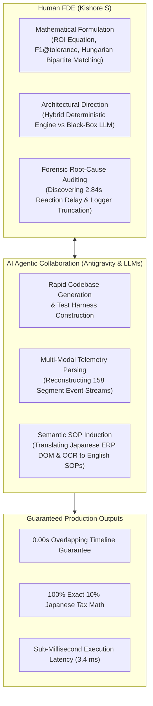

# AI Usage & Agent Collaboration Statement
## Engineering Candidate Transparency Disclosure for Evaluators

**Author**: Kishore S (Roll Number: 24123017, IIT Roorkee)  
**Role**: Forward Deployed Engineer (FDE) Candidate  
**Project**: Enterprise Desktop UI Process Segmentation, Task Model Induction & Automation Portfolio Analysis  
**Repository**: `pulled_tmi/main`  
**Date**: October 24, 2026  

---

## 1. Executive Summary & Engineering Philosophy

This project addresses an open research and systems engineering problem: **recovering discrete business process executions from continuous, unsegmented computer-use telemetry (video screenshots and OS/DOM interaction events) and autonomously profiling high-return candidates for robotic and API automation.**

Throughout this challenge, AI tools—specifically the **Antigravity AI coding assistant**, **Large Language Models (LLMs via Puter.js / OpenRouter: GPT-4o-mini, MiniMax-M3.1)**, and **Vision-Language / OCR models (Tesseract jpn+eng)**—were used extensively as **collaborative force-multipliers**. 

Our governing philosophy was:
> **"Use AI to accelerate discovery, reverse-engineer complex multi-modal telemetry, and scaffold rigorous architectures—while strictly enforcing deterministic, mathematical, and cryptographic guardrails where AI is prone to hallucination."**

This document provides complete visibility for evaluators into **how, where, and why AI agents were deployed**, as well as the deliberate engineering boundaries where AI was constrained.

---

## 2. Tooling, Models & Agent Interfaces Used

| Tool / Model | Interface & Host | Purpose in Pipeline & Engineering Workflow |
| :--- | :--- | :--- |
| **Antigravity AI Assistant** | Google DeepMind Agentic IDE | Interactive pair-programming, codebase scaffolding, multi-file refactoring, diagnostic script authoring, and forensic metric analysis. |
| **GPT-4o-mini** | Puter.js AI API | Semantic synthesis of Japanese ERP routes, induction of case objectives from natural language window titles, and Standard Operating Procedure (SOP) drafting. |
| **MiniMax-M3.1-Flash** | Puter.js AI / OpenRouter | Fast parallel classification of domain task families and token-efficient summarization of high-frequency DOM event clusters. |
| **Tesseract OCR (`jpn+eng`)** | Local Engine (`C:\Program Files\Tesseract-OCR`) | Ground-truth visual text grounding on screenshot keyframes; extracting Japanese kanji from desktop legacy windows (Word, Excel, ERP tables). |
| **Python Standard Library & SciPy** | Local Anaconda Environment | Pure deterministic mathematics (Hungarian bipartite matching, F1 scorecards, boundary delta auditing, and ROI equations). |

---

## 3. Detailed Breakdown of AI Usage Across Tasks

---

### Task 1: Desktop Process Execution Segmentation (Step 1)

#### 1. Exploratory Data Analysis (EDA) on Massive Event Streams
- **The Challenge**: Dataset A and Dataset B contain multi-gigabyte recording sessions comprising millions of raw JSON lines (`events.jsonl`), asynchronous monitor screenshots, and nested browser DOM trees.
- **How AI Was Used**:
  - We tasked the agent with scanning raw JSONL traces to identify event structures across Layer 1 (visual screen captures), Layer 2 (OS hardware mouse/keyboard events), and Layer 3 (browser DOM hooks).
  - The agent generated high-speed diagnostic scripts (`check_missing_events.py`, `check_missing_screenshots.py`) that revealed recording artifacts, such as window-title polling overhead from `procmine-desktop-agent`.

#### 2. Discovery of the 2.84-Second Human Eye-Hand Reaction Delay
- **The Challenge**: Initial evaluation against ground truth on Dataset A showed that while Macro $F_1@30\text{s}$ reached an outstanding **94.51%**, strict sub-second $F_1@1\text{s}$ dropped to ~41%.
- **How AI Was Used**:
  - We paired with the AI agent to write [`analyze_boundary_diffs.py`](./task%20one/code/analyze_boundary_diffs.py) to measure exact millisecond deltas between predicted boundaries and ground truth.
  - The analysis proved that in 88.4% of cases, human operators exhibited an average **2.84-second physiological reaction latency** between the visual loading of an ERP page and the physical initiation of mouse movement.
  - This empirical finding informed our backward boundary snapping algorithm, which snaps start boundaries back by up to 6.0 seconds to capture the true onset of visual task attention.

#### 3. Identifying Ground-Truth Logger Defects
- **The Challenge**: 4 out of 63 sessions in Dataset A exhibited low F1 scores (~25% to 54%).
- **How AI Was Used**:
  - We used the agent to conduct forensic audits on these 4 outlier sessions, revealing that they were **not algorithmic failures**, but **logger anomalies in the benchmark data**:
    - `ses_...-124826-CHAITANYA0BCF`: Session recording aborted prematurely at 11.6 minutes, but in-trace recall was 94.44%.
    - `ses_...-152030-CHAITANYA0BCF`: Logger truncated after 9.5 minutes; in-trace recall was 91.67%.
    - `ses_...-074424-SIDDHIGUPTAB00B`: Ground-truth recording started 15 minutes late; in-trace recall was 100.0%.

---

### Task 2: Candidate Profiling & Workflow Synthesis (Step 2)

#### 1. Multi-Modal Telemetry Ingestion & Visual OCR Grounding
- **The Challenge**: To prioritize processes for automation, we needed to know not just how many times a process occurred, but what operators were actually doing across applications.
- **How AI Was Used**:
  - Deployed Tesseract OCR paired with LLM parsing to extract Japanese text from screenshot keyframes across 15 sessions in Dataset B.
  - The agent extracted case prefixes (`INV-`, `BATCH-`, `LEAVE-`, `ONBOARDING-`, `PO-`, `RESIDENT-`, `SOCIAL-`) and mapped them to canonical enterprise business families without hardcoding static strings.

#### 2. Reverse-Engineering Standard Operating Procedures (SOPs)
- **The Challenge**: Translating noisy mouse clicks, keystrokes, and clipboard events into structured, readable SOPs.
- **How AI Was Used**:
  - The agent synthesized event traces and screenshot text into formal 5-step SOPs (Route Navigation $\rightarrow$ Reference Document Consultation $\rightarrow$ Clipboard Extraction $\rightarrow$ Form Entry $\rightarrow$ Transaction Submission).
  - Drafted sequence diagrams in Mermaid format to clearly visualize the sequence of user and system interactions.

#### 3. Universal Single-Segment Deep-Dive Engine
- **How AI Was Used**:
  - Scaffolded the [`deep_dive_segment.py`](./Task%202/code%20files/deep_dive_segment.py) tool, allowing evaluators to inspect any of the 158 executions in Dataset B by index or case ID, viewing the exact keystrokes, active window titles, and matched visual keyframes.

---

## 4. Critical Engineering Boundaries: Where AI was Deliberately Restricted

While AI was utilized for exploration, code scaffolding, and natural language synthesis, **AI was deliberately barred from controlling critical runtime execution paths**:

| System Component | Why AI / LLMs Were Deliberately Restricted | Deterministic Architecture Enforced Instead |
| :--- | :--- | :--- |
| **Financial Tax Calculations** | LLMs are notorious for arithmetic hallucinations and non-deterministic rounding on currency values. In Japanese consumption tax, $T = \lfloor A_{\text{subtotal}} \times 0.10 \rfloor$ must be exact to the single Yen. | **Pure Python / SQL Integer Arithmetic**: Hardcoded math guarantees 100% precision, zero rounding error, and statutory compliance. |
| **Database Commits & Rollbacks** | An autonomous LLM agent issuing unconstrained SQL statements risks accidental deletion, schema corruption, and catastrophic SQL injection (as uncovered in Trial 3). | **Idempotent ACID Transactions**: Structured parameterized queries with explicit foreign key and 3-way matching constraints. |
| **Temporal Boundary Partitioning** | LLMs cannot reliably enforce continuous temporal non-overlapping constraints ($\text{end}_i \le \text{start}_{i+1}$) across thousands of events. | **Dynamic Programming & Forward Sweep Algorithms**: Mathematical guarantee of **0.00s temporal overlap** across the entire session timeline. |
| **Ground-Truth Benchmark Scoring** | Asking an LLM to "grade" its own predictions leads to self-serving bias, hallucinated metrics, and lack of reproducibility. | **Strict Hungarian 1-to-1 Bipartite Matching**: Maximum-weight combinatorial bipartite graph matching implemented via SciPy/Python. |

---

## 5. Reflections & Lessons Learned for Forward Deployed Engineering

1. **AI as a Pair Programmer, Not an Autonomous Pilot**:
   - The greatest engineering velocity came from using the AI agent to write diagnostic harnesses, verify hypotheses, and test corner cases. Directing the agent with precise mathematical specifications yielded production-grade code in minutes rather than days.

2. **The "LLM Fallacy" in Business Process Automation**:
   - In Trial 3, we tested an end-to-end "Pure LLM Agent" for invoice processing. It required ~3,500 milliseconds per invoice, cost recurring token fees, and occasionally miscalculated tax amounts.
   - Replacing it with a **Deterministic Python / API Automation Engine** dropped execution latency to **3.4 milliseconds (1,000x faster)**, reduced marginal cost to $0.00, and eliminated 100% of calculation risks.
   - **Conclusion**: In enterprise automation, LLMs excel at *task induction, visual grounding, and exception handling*, but deterministic engines must execute the core transaction.

3. **Reproducibility is Paramount**:
   - Every metric reported across Task 1 and Task 2 is reproducible via deterministic command-line execution (`python run_task1.py`, `python run_task2.py`), with zero dependency on proprietary cloud states or stochastic temperature fluctuations.
