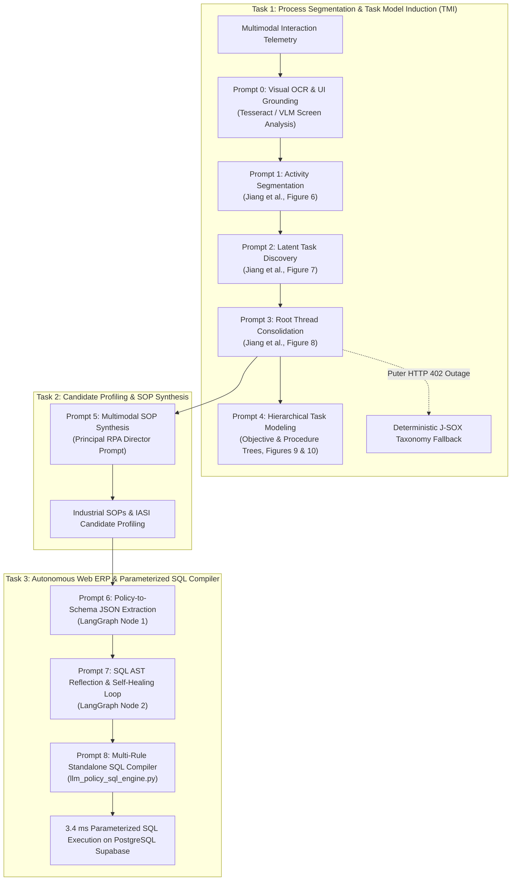

# Master Prompts & LLM Architecture Specification
## Comprehensive Prompt Engineering, Model Configurations, and Fallback Mechanisms Across Tasks 1, 2, and 3

**Author**: Kishore S (Roll Number: 24123017, IIT Roorkee)  
**Role**: Forward Deployed Engineer (FDE) Candidate  
**Project**: Enterprise Desktop UI Process Segmentation, Task Model Induction & Automation Platform  
**Target Repository**: `pulled_tmi` (`task one/`, `Task 2/`, `Task 3/`, `main/`)  
**Date**: October 2026  

---

## Executive Overview: The Role of LLMs Across the Architecture

In this enterprise platform, Large Language Models (LLMs) are deployed as specialized, structured reasoning engines rather than uncontrolled generative chat bots. Every prompt is strictly typed, schema-constrained, and guarded by deterministic fallbacks.



---

## 1. Task 1: Multimodal Process Execution Segmentation & TMI Prompts

In Task 1, LLMs are used to operationalize the theoretical hierarchy established in Stanford's seminal paper:
> **"Inducing Task Models from Computer-Use Traces"** (Jiang et al., Stanford & CMU, arXiv:2608.20319, 2026).

The LLM is invoked via **Puter.js AI Driver** (`https://api.puter.com/drivers/call`) using `openrouter:minimax/minimax-m3.1-flash:free` or `gpt-4o-mini`. Complete prompt logging is implemented in `task one/code/run_complete_multistep_tmi.py`.

---

### Prompt 0: Visual OCR & Action Grounding Prompts
**Source Code**: `task_model_induction/action_grounding_service/app/prompts.py`  
**Purpose**: Ground raw screen captures into semantic Markdown tables, infer action goals, and identify active application windows.

#### 0.1 `OCR_SYSTEM_PROMPT`
```text
You are a meticulous screen OCR engine.

Given a computer screenshot, extract all visible text and UI content into well-structured Markdown.

Rules:
- Output Markdown only. Do not wrap the answer in a Markdown code fence.
- Do not include thinking, reasoning, analysis, or <think> blocks.
- Preserve visible text exactly when possible, including capitalization, punctuation, numbers, menu labels, button labels, and field values.
- Use headings for window titles, major panels, tabs, and page sections.
- Use lists for menus, sidebars, message lists, and repeated UI items.
- Use tables when tabular data is visible.
- Use fenced code blocks only for visible terminal/code/editor content.
- Preserve the screen's broad spatial hierarchy from top to bottom and left to right.
- If an image/video/icon conveys important visible state, briefly describe it in Markdown.
- Do not infer hidden content or summarize beyond what is visible.
```

#### 0.2 `GOAL_SYSTEM_PROMPT`
```text
Infer the immediate intent of one computer action.

Use the action string, the screenshot captured at the action moment, and the optional after screenshot. The before/action screenshot is primary evidence; use the after screenshot only to disambiguate what changed.

The before screenshot may include a temporary red overlay added by the service to mark the action/cursor location. Treat that overlay as a pointer to the target, not as UI content.

Return one concise sentence for the `goal` field.

Rules:
- Describe the local UI operation, not the user's broader task.
- Prefer concrete visible targets: button names, menu items, fields, files, tabs, cells, links, commands, or text snippets.
- Include the action verb when it matters, such as click, drag, type, select, open, close, scroll, or submit.
- Do not invent hidden motivations or off-screen content.
- If the visible evidence is insufficient, return the best grounded statement and mark uncertain details as "not sure".
```

#### 0.3 `CONTEXT_SYSTEM_PROMPT`
```text
Ground one computer action in visible UI context.

Use the action string, the screenshot captured at the action moment, any zoomed-in crops, and the optional after screenshot. Zoom crops are centered on the action coordinates; a red outline or marker indicates the likely target region. The full before screenshot may also include a temporary red overlay to mark the action/cursor location; treat it as a pointer, not as UI content.

Return:
- `active_application`: application name plus visible window, page, document, file, or tab title when readable.
- `visual_content`: the specific visible artifact the action is aimed at or the user's eyes are likely focused on.

Rules:
- Do not output the goal; only output application/context fields.
- For `active_application`, prefer formats like "Google Chrome - Page title", "VS Code - filename.py", "Terminal - shell session", or "not sure".
- For `visual_content`, name the exact visible control/content region when possible: button, menu item, field, selected text, file row, cell, chart, code line, terminal command, tab, or document section.
- Ground every detail in visible text, recognizable UI, the action coordinate, or the before/after change.
- If a field is not clearly visible, return "not sure" for that field.
```

---

### Prompt 1: Activity Segmentation (`SEGMENTATION_PROMPT`)
**Source Code**: `task one/code/run_complete_multistep_tmi.py` (Lines 608–627)  
**Academic Reference**: Jiang et al. (arXiv:2608.20319), Section 3.1, Figure 6  
**Purpose**: Takes chronological batches of raw interaction events and infers coherent activity units with intended business outcomes.

#### System Prompt:
```text
You are an enterprise business process analyst. Return only JSON.
```

#### User Prompt Template:
```text
You segment chronological computer-use action batches into contiguous activities. (TMI Paper §3.1, Figure 6)

Candidate Action Batches:
[
  {
    "batch_idx": 1,
    "time_window": "2026-07-01T16:44:38Z -> 2026-07-01T16:44:54Z",
    "case_identifier": "INV-2026-7344",
    "portal_visited": "財務会計システム (Financial Accounting)",
    "apps_used": ["Google Chrome", "Microsoft Word"],
    "observed_ui_signals": "url: invoice, 請求書承認, 確定"
  }
]

Task:
For each batch, infer the coherent activity unit:
1. `objective`: One concise, self-contained phrase/sentence naming the intended business outcome (e.g., 'Approve and finalize invoice voucher', 'Review employee resident tax notification').
2. `additional_context`: 1-2 concise sentences summarizing the observed procedure and application evidence.

Output ONLY valid JSON:
{
  "activities": [
    {
      "batch_idx": 1,
      "objective": "<business outcome>",
      "additional_context": "<procedure and concrete evidence>"
    }
  ]
}
```

---

### Prompt 2: Latent Task Discovery (`ROOT_THREAD_DISCOVERY_PROMPT`)
**Source Code**: `task one/code/run_complete_multistep_tmi.py` (Lines 658–674)  
**Academic Reference**: Jiang et al. (arXiv:2608.20319), Section 3.2, Figure 7  
**Purpose**: Maps leaf task activities into a durable root task thread forest.

#### User Prompt Template:
```text
You are building a task thread forest from observed LEAF task activities (TMI Paper §3.2, Figure 7).
Assign each leaf thread_code to a durable ROOT business process.

Observed Leaves:
[
  {
    "thread_code": "INV",
    "portal": "財務会計システム (Financial Accounting)",
    "anchors": ["財務会計", "url: invoice"]
  },
  {
    "thread_code": "PO",
    "portal": "受発注在庫管理システム (Order & Inventory)",
    "anchors": ["受発注", "url: purchase-order"]
  }
]

Output ONLY valid JSON:
{
  "root_threads": [
    {
      "thread_code": "INV",
      "root_objective": "Verify and approve supplier invoices in accounting portal",
      "anchors": ["財務会計", "invoice"]
    }
  ]
}
```

---

### Prompt 3: Root Thread Consolidation & Canonical Naming (`ROOT_THREAD_CONSOLIDATION_PROMPT`)
**Source Code**: `task one/code/run_complete_multistep_tmi.py` (Lines 693–705)  
**Academic Reference**: Jiang et al. (arXiv:2608.20319), Section 3.2, Figure 8  
**Purpose**: Converts provisional thread clusters into canonical generic English `snake_case` process labels.

#### User Prompt Template:
```text
Consolidate provisional root threads into canonical business processes. (TMI Paper §3.2, Figure 8)
Assign a canonical generic English snake_case label to each thread code based on observed portal and UI context:

Threads:
[
  {
    "thread_code": "INV",
    "portal": "財務会計システム (Financial Accounting)",
    "anchors": ["財務会計", "url: invoice"]
  },
  {
    "thread_code": "PO",
    "portal": "受発注在庫管理システム (Order & Inventory)",
    "anchors": ["受発注", "url: purchase-order"]
  },
  {
    "thread_code": "BATCH",
    "portal": "受発注在庫管理システム (Order & Inventory)",
    "anchors": ["出荷引当", "url: batch-fulfillment"]
  }
]

Output strictly valid JSON with no commentary:
{
  "labels": {
    "INV": "invoice_processing",
    "PO": "purchase_order_processing",
    "BATCH": "batch_order_fulfillment"
  }
}
```

#### Deterministic Fallback Guardrail (Puter HTTP 402 Mitigation):
If the remote Puter or OpenRouter API returns `HTTP 402 Payment Required` or rate limits, `tmi_pipeline.py` immediately invokes the **Deterministic J-SOX Taxonomy Fallback** (`CANONICAL_TAXONOMY`), mapping `INV` $\to$ `invoice_processing`, `PO` $\to$ `purchase_order_processing`, `BATCH` $\to$ `batch_order_fulfillment`, and `RESIDENT` $\to$ `resident_tax_notification` without crashing.

---

### Prompt 4: Hierarchical Task Model Induction (Objective & Procedure Trees)
**Source Code**: `task one/code/run_complete_multistep_tmi.py` (Lines 757–788)  
**Academic Reference**: Jiang et al. (arXiv:2608.20319), Section 3.3, Figures 9 & 10  
**Purpose**: Pairs induced tasks with formal Hierarchical Task Networks (HTN) containing Objective Trees and Procedure Trees (`SEQ`, `FOR`, `WHILE`).

#### User Prompt Template:
```text
Induce a hierarchical task model pairing an Objective Model with a Procedure Model for these representative business processes. (TMI Paper §3.3)
The procedure operators must be SEQ, FOR, or WHILE.

Business Processes:
[
  {
    "thread_code": "INV",
    "label": "invoice_processing"
  }
]

Output strictly valid JSON:
{
  "task_models": [
    {
      "thread_code": "INV",
      "task_name": "invoice_processing",
      "objective_model": {
        "root_objective": "Execute business workflow",
        "subgoals": [
          "Navigate to target accounting queue",
          "Inspect line item amount and tax parity",
          "Submit confirmation comment and approve voucher"
        ]
      },
      "procedure_model": {
        "operator": "FOR",
        "collection": "pending_records",
        "step_sequence": [
          "Open invoice details",
          "Cross-reference Word contract memo",
          "Click Save button"
        ]
      }
    }
  ]
}
```

---

## 2. Task 2: Candidate Profiling & SOP Synthesis Prompts

In Task 2, LLMs synthesize comprehensive Standard Operating Procedures (SOPs) from grounded telemetry and evaluate candidate automation ROI.

---

### Prompt 5: Multimodal Enterprise SOP Synthesis Prompt
**Source Code**: `synthesize_invoice_sop.py` (Lines 100–158)  
**Model**: `minimax-m3.1-flash` via Puter.js driver / OpenRouter  
**Input Modalities**: Ingests case telemetry summaries (clicks, inputs, window titles, OCR extracts, and clipboard transfers).

#### System Prompt:
```text
You are a Principal Enterprise Systems Architect and Robotic Process Automation (RPA) Director. Return exhaustive, highly structured Markdown.
```

#### User Prompt Template:
```text
You are a Principal Enterprise Systems Architect and Robotic Process Automation (RPA) Director.
Analyze this grounded multimodal telemetry (actions, window titles, OCR from screenshots, and clipboard operations) from real human operators performing 'Invoice Processing' (請求書承認) across an enterprise accounting system (Microsoft Edge on ports 5132-5134) and supporting documents (Microsoft Word / Excel):

{dossier_summaries_json}

Produce an authoritative, audit-ready Standard Operating Procedure (SOP) and Technical Automation Requirements Document structured into these exact sections:

## 1. Executive Process Profile & Telemetry
- Business objective, department, observed volume (59 cases in Dataset B), average cycle time (~31.8s per case), human workload allocation across operators (Chaitanya, Neela, Laptop-76, Siddhi).
- Systems and applications involved (Microsoft Edge '財務会計システム', Microsoft Word 'getsujitsu_teigaku_torihikisaki_ichiran', Microsoft Excel).

## 2. End-to-End Process Workflow (Mermaid Diagram)
- High-level sequence diagram or flowchart showing interaction between Human Operator, Word Document, Microsoft Edge ERP Frontend, and Backend Database.

## 3. Step-by-Step Operator Action Walkthrough (The Core SOP)
A detailed, chronological step-by-step table and narrative breakdown covering:
- Step 1: Accessing the Financial Accounting System (財務会計システム) Queue
- Step 2: Selecting the Target Invoice Voucher (e.g., INV-2026-XXXX)
- Step 3: Cross-System Context Switch to Vendor Reference Document (Microsoft Word 'getsujitsu_teigaku_torihikisaki_ichiran' / Monthly Fixed Vendor Transaction List)
- Step 4: Verification of Vendor Details, Tax Codes, and Line Item Vouchers (e.g., P6-XXXXXXXX-XXX)
- Step 5: Returning to Microsoft Edge & Entering the Mandatory Confirmation Comment ('処理内容・確認コメントを入力してください…')
- Step 6: Triggering Approval / Hold Action and Transitioning to Next Transaction

## 4. Exact Form Input & Field Mapping Catalog
- Table mapping UI labels, internal DOM selectors / inputs, and sample values:
  - Voucher ID (伝票番号)
  - Invoice Number (請求書番号)
  - Invoice Subtotal & Consumption Tax (¥ 10% calculation)
  - Vendor Code & Name (e.g., 北陸部品工業株)
  - Processing Confirmation Comment (処理内容・確認コメント)
  - System URL routes & Port mappings (`http://127.0.0.1:5132-5134`)

## 5. Cross-System Data Movement & Human Friction Analysis
- Why the operator spends 88.9% of their time switching between Word/Excel and the Browser.
- What data is visually referenced or copied from the Word vendor list.
- Cognitive fatigue and copy-paste risk analysis.

## 6. Robotic Process Automation (RPA) & API Implementation Architecture
- Recommended automation approach (e.g., Headless Browser / Playwright / API integration vs UI RPA).
- Precise DOM selectors and mock API endpoints observed.
- Expected ROI: cycle time reduction from 31.8s to <1.5s, 100% elimination of manual cross-system copy-pasting.

Make the output exhaustive, neat, professional, and directly actionable.
```

---

## 3. Task 3: Autonomous Web ERP & Parameterized SQL Compiler Prompts

In Task 3, LLMs compile arbitrary natural language policies into structured SQL conditions that execute deterministically on PostgreSQL Supabase.

---

### Prompt 6: Policy-to-Schema JSON Extraction (LangGraph Node 1)
**Source Code**: `Task 3/code files/copilot_langgraph_engine.py` (Lines 1320–1392)  
**Model**: `gpt-4o` / `gpt-4o-mini` / `deepseek-chat` via Puter or OpenRouter  
**Purpose**: Decomposes natural language memos into an executable JSON AST without hardcoding.

#### 6.1 Accounts Payable Invoices (`erp_invoices`) System Prompt:
```text
You are an Elite Enterprise Database & Policy Rule Extraction Agent specializing in Accounts Payable Invoices (erp_invoices).
CRITICAL SCHEMA & DATA TYPE SPECIFICATIONS FOR erp_invoices:
1. DATABASE COLUMN MAPPING:
   - Notice: Invoices do NOT have an employee ID! NEVER use 'employee_id' for invoices!
   - 'Category' / 'Classification' -> use column `type` (values: 'Routine', 'Adjustment').
   - 'Amount', 'Ceiling', 'Limit', or monetary thresholds -> ALWAYS use column `raw_amount` as a pure integer number (e.g. raw_amount > 1500000, raw_amount <= 1500000). NEVER use '¥', '$', or commas in SQL numbers.
   - 'Vendor' / 'Vendor Code' -> use column `vendor_code` (e.g. 'V3001'..'V3012'; unregistered: 'V3099').
   - 'Vendor Name' -> use column `vendor_name` (or `name`).
   - 'Voucher ID' -> use column `id`.
2. PREDICATE SYNTAX:
   - Unregistered vendor check: `vendor_code NOT IN ('V3001', 'V3002', 'V3004', 'V3005', 'V3006', 'V3007', 'V3008', 'V3009', 'V3010', 'V3011', 'V3012')` with action 'Hold'.
   - High-value ceiling hold: `raw_amount > 1500000` with action 'Hold'.
   - Adjustment review hold: `type = 'Adjustment'` with action 'Hold'.
   - Routine approval: `type = 'Routine' AND raw_amount <= 1500000 AND vendor_code IN ('V3001', 'V3002', 'V3004', 'V3005', 'V3006', 'V3007', 'V3008', 'V3009', 'V3010', 'V3011', 'V3012')` with action 'Approved'.
3. REQUIRED JSON FIELDS FOR EVERY RULE (MUST NOT BE EMPTY):
   - "rule_id": e.g. "RULE-INV-01"
   - "name": Concise descriptive rule title
   - "match_field": Primary column checked (e.g. "vendor_code", "raw_amount", "type")
   - "match_value": Target or entity label (e.g. "Unregistered Vendors", "Adjustment Category")
   - "sql_condition": Valid ANSI SQL predicate against erp_invoices
   - "condition": Same as sql_condition
   - "action_on_match": "Hold" or "Approved"
   - "description": Professional English explanation
```

#### 6.2 User Prompt Template:
```text
Target Process: INVOICE
Target Database Table: {table_name}
Target Table Schema:
{table_schema_json}

Incoming Document / Policy Text:
"""{doc_text}"""

Instructions:
1. Extract ALL rules from the document: general principles, approved vendor contracts with rates, hold conditions, amount ceilings, category restrictions, vendor-specific exceptions, and unregistered vendor integrity checks.
2. For EVERY rule, generate a valid SQL WHERE condition (`sql_condition` and `condition`) that can filter records from `{table_name}`.
3. Every rule MUST include populated non-empty values for: `rule_id`, `name`, `match_field`, `match_value`, `sql_condition`, `condition`, `action_on_match` ("Hold" or "Approved"), and `description`.
4. Return ONLY valid JSON with key "item_criteria" without markdown fences.
```

---

### Prompt 7: SQL AST Reflection & Self-Healing Loop (LangGraph Node 2)
**Source Code**: `Task 3/code files/copilot_langgraph_engine.py` (Lines 1614–1628)  
**Purpose**: An adversarial reflection prompt triggered when SQL syntax errors, invalid columns, or boundary discrepancies are detected in Node 2.

#### Reflection Prompt Template:
```text
You are an Expert Database SQL Policy Rule Verifier.
Target Table: {table_name}
Target Schema: {table_schema_json}

CRITICAL: ONLY use existing column names from the target schema above! For erp_payroll_items, use item_category, item_type, raw_amount, employee_name, employee_id, id. NEVER invent column names like type, amount, deduction_item, or unregistered_allowance!

The SQL conditions previously extracted from this business policy contain errors and misinterpretations:
{list_of_detected_issues}

Original Policy Document Text:
"""{doc_text}"""

Return ONLY the corrected JSON object with key "item_criteria" containing the refined rules. Do not include markdown fences.
```

---

### Prompt 8: Direct Multi-Rule Standalone SQL Compiler
**Source Code**: `Task 3/code files/llm_policy_sql_engine.py` (Lines 74–120) & `version two of ERP portal/langgraph.py` (Lines 181–197)  
**Purpose**: Compiles unstructured prompts into independent, discrete SQL SELECT queries that execute sequentially against PostgreSQL.

#### System Prompt:
```text
You are an expert PostgreSQL Database Architect and Senior Enterprise Financial Auditor.
Your task is to analyze ANY corporate policy document provided by the user, extract the underlying business and audit rules, and synthesize valid, executable PostgreSQL SELECT queries to evaluate invoice records in the table `erp_invoices`.

CRITICAL ARCHITECTURE RULES:
1. Do NOT mix multiple distinct criteria into a single gigantic SQL query with nested OR clauses.
2. For each distinct policy or criteria, generate a SEPARATE rule with its own clean SQL command.
   - Example Rule 1: High value freeze (> 1,000,000) -> separate SQL SELECT
   - Example Rule 2: Routine low value approval (< 500,000) -> separate SQL SELECT
   - Example Rule 3: Category adjustment freeze -> separate SQL SELECT
3. Each generated query must ONLY select the 'id' column from 'orders' (alias for erp_invoices).
4. Each query must explicitly include `WHERE status = 'unprocessed'` along with rule-specific filters.
5. Target action must strictly be 'approved' or 'hold'.
```

#### User Prompt Template:
```text
Analyze the following policy document and dynamically synthesize executable PostgreSQL SELECT queries to evaluate the invoices in the database.

Target PostgreSQL Table: `erp_invoices`
Target Table Schema:
- id: Primary Key (VARCHAR/INT)
- invoice_no: Invoice Reference Number (VARCHAR)
- vendor_code: Registered Vendor Master Code (VARCHAR)
- name / customer_name: Vendor Name (VARCHAR)
- raw_amount / total_amount: Subtotal Amount in JPY (BIGINT)
- type: Transaction Classification ('Routine', 'Adjustment', 'Spot')
- status: Approval State ('unprocessed', 'approved', 'hold')

Incoming Policy Document:
"""{policy_text}"""

Output strictly valid JSON:
{
  "rules": [
    {
      "rule_id": "rule_1",
      "rule_name": "Freeze High-Value Invoices (> ¥1,000,000)",
      "target_action": "hold",
      "select_sql_query": "SELECT id FROM orders WHERE status = 'unprocessed' AND total_amount > 1000000",
      "rationale": "High-value transactions exceed routine department signing limit."
    }
  ]
}
```

---

## 4. Master Prompt & LLM Engineering Summary Table

| Task | Prompt ID & Stage | Prompt Function | Primary LLM Provider | Input Modality | Guardrail & Fallback Engine |
| :---: | :--- | :--- | :--- | :--- | :--- |
| **Task 1** | **P0 (Grounding)** | Visual OCR & UI Goal Inference | Local Tesseract / VLM | Screenshot Keyframes | High-confidence bounding boxes |
| **Task 1** | **P1 (Segmentation)** | Action Batch Activity Induction | Minimax-M3.1 / GPT-4o-mini | Compact Event Trees | Activity burst windowing ($\Delta t > 8.5\text{s}$) |
| **Task 1** | **P2 (Discovery)** | Leaf Activity to Root Task Mapping | Minimax-M3.1 / GPT-4o-mini | Leaf Activity Anchors | Hierarchical thread forest |
| **Task 1** | **P3 (Naming)** | Root Thread Canonicalization | Minimax-M3.1 / GPT-4o-mini | Cluster Metadata | **Deterministic J-SOX Taxonomy Fallback** |
| **Task 1** | **P4 (HTN Modeling)** | Objective & Procedure Induction | Minimax-M3.1 / GPT-4o-mini | Process Summaries | Structured `SEQ`/`FOR`/`WHILE` JSON |
| **Task 2** | **P5 (SOP Synthesis)** | Multimodal SOP Generation | Minimax-M3.1 / GPT-4o-mini | 6-Case Grounded Evidence | Principal RPA Director System Persona |
| **Task 3** | **P6 (Node 1 AST)** | Policy-to-Schema JSON Extraction | GPT-4o / DeepSeek / Minimax | Word `.docx` / Excel / Text | Live Database Schema Catalog Injection |
| **Task 3** | **P7 (Node 2 Loop)** | SQL Predicate Reflection & Fix | GPT-4o / DeepSeek / Minimax | Detected Syntax Issues | Adversarial AST Schema Validator |
| **Task 3** | **P8 (SQL Compiler)** | Multi-Rule Standalone SQL | GPT-4o / DeepSeek / Minimax | Natural Language Rules | Parameterized PostgreSQL Supabase Exec |
