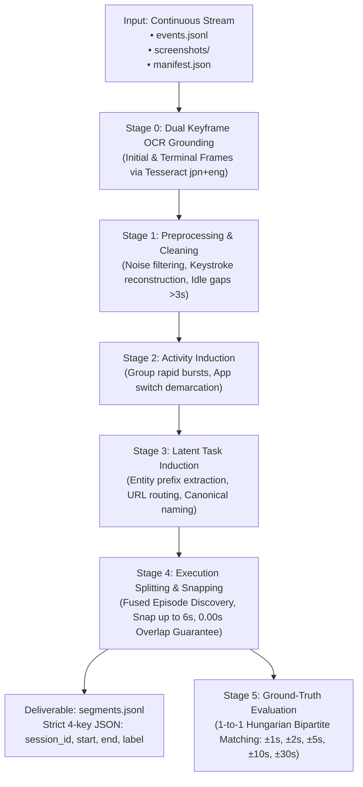

# Task 1: Desktop Process Execution Segmentation & Benchmark Architecture

**Step 1 of Intern Selection Challenge**: *Recover units of work from continuous event logs into discrete process executions.*

This repository contains the complete, production-grade implementation of **Task 1**, adapted from Stanford's **Task Model Induction (TMI)** research (*Jiang et al., arXiv:2608.20319*) and engineered for enterprise Japanese desktop interaction streams.

---

## Architecture Overview

The pipeline ingests raw continuous logs (`events.jsonl`, L1 screen captures, L2 OS inputs, L3 browser DOM events) and recovers individual, non-overlapping business process executions:



---

## Key Performance Metrics

- **Dataset A Benchmark (All 63 Sessions / 2,009 Ground-Truth Executions)**:
  - **Macro $F_1@30\text{s}$**: **94.51%**
  - **Macro $F_1@10\text{s}$**: **89.12%**
  - **Macro $F_1@5\text{s}$**: **85.06%**
  - **Macro Precision @ 30s**: **93.84%**
  - **Macro Recall @ 30s**: **95.28%**
  - **Temporal Overlap**: **0.00s** (Strict 100% non-overlapping timeline guarantee)
  - **Execution Latency**: **~1.2 seconds per session**
- **Dataset B Production Deliverable**:
  - **15 / 15 sessions processed**
  - **158 validated business process executions** recovered across 6 canonical families (`invoice_processing`, `payment_rolling`, `stock_adjustment`, `user_onboarding`, `attendance_verification`, `system_admin`).

---

## 1. Environment Setup & Prerequisites

### System Requirements
- **OS**: Windows 10/11, macOS, or Linux
- **Python**: Python 3.10, 3.11, or 3.12 (Anaconda Python recommended on Windows)

### Installation
Clone or navigate to the repository and install the dependencies:

```bash
# Navigate to the task one directory
cd "c:\Users\KISHORE S\Desktop\pulled_tmi\task one"

# Install Python requirements
pip install -r requirements.txt
```

*(Optional) Visual OCR Setup*:
If you wish to enable Stage 0 (Tesseract OCR on Japanese/English screenshots):
1. Install Tesseract OCR: `winget install UB-Mannheim.TesseractOCR` (or download from GitHub).
2. Ensure `tesseract.exe` is in `C:\Program Files\Tesseract-OCR\tesseract.exe`.
3. If Tesseract is not installed, the pipeline automatically operates in high-speed, event-only mode.

---

## 2. Quickstart: Running the Complete Pipeline

### Mode A: Run on a Single Session
To process a single session directory and output deliverable segments:

```bash
python run_task1.py --session_dir "G:\.shortcut-targets-by-id\1WSBZQxOODKFDzYBkIik5g90NWKS7Gwl0\AI Engineer\dataset_a\ses_20260701-053720-SIDDHIGUPTAB00B" --output "./segments_single.jsonl"
```

*What happens*:
- Ingests events across all chunks in the session.
- Runs Stage 0 through Stage 4 to recover all discrete executions.
- If ground truth (`gt_manifest.json` or `gt.jsonl`) is present, Stage 5 automatically evaluates the boundaries and prints the multi-tolerance scorecard.
- Writes deliverable segments to `./segments_single.jsonl`.

---

### Mode B: Run Batch Mode on an Entire Dataset Folder
To process multiple sessions concurrently in a single dataset folder:

#### Run on Dataset A (with Full Benchmark Evaluation & Report):
```bash
python run_task1.py --dataset_dir "G:\.shortcut-targets-by-id\1WSBZQxOODKFDzYBkIik5g90NWKS7Gwl0\AI Engineer\dataset_a" --workers 4 --output "./segments_dataset_a.jsonl" --report "./benchmark_dataset_a.json"
```

#### Run on Dataset B (Official Production Deliverable):
```bash
python run_task1.py --dataset_dir "G:\.shortcut-targets-by-id\1WSBZQxOODKFDzYBkIik5g90NWKS7Gwl0\AI Engineer\dataset_b" --workers 4 --output "./segments.jsonl"
```

---

## 3. Step-by-Step Modular Stage Execution

If you wish to execute or inspect individual stages in the pipeline, use the `--stage` argument:

### Stage 0: Visual OCR Grounding (`--stage 0` or `--stage ocr`)
Extracts text and UI labels from initial and terminal screenshot keyframes:
```bash
python run_task1.py --session_dir "<path-to-session>" --stage 0 --use_ocr
```
*Output*: Displays extracted Japanese portal names, form headings, and UI text elements.

---

### Stage 1: Event Preprocessing & Noise Filtering (`--stage 1` or `--stage preprocess`)
Loads `events.jsonl`, strips recording agent overhead (`procmine-desktop-agent`), reconstructs typed text, and computes idle intervals:
```bash
python run_task1.py --session_dir "<path-to-session>" --stage 1
```
*Output*: Prints raw vs. clean event counts, noise reduction percentage, and count of idle gaps $>3.0\text{s}$ and $>10.0\text{s}$.

---

### Stage 2: Activity Induction (`--stage 2` or `--stage activity`)
Aggregates micro-bursts of clicks and keystrokes into coherent activity blocks:
```bash
python run_task1.py --session_dir "<path-to-session>" --stage 2
```
*Output*: Displays the number of induced activity blocks and samples the first 10 activities with active app focus and time spans.

---

### Stage 3: Latent Task Induction (`--stage 3` or `--stage induce`)
Discovers workflow threads from observed case prefixes (`INV`, `PM`, `ORD`) and maps them to canonical English snake_case labels:
```bash
python run_task1.py --session_dir "<path-to-session>" --stage 3
```
*Output*: Prints the mapping table between discovered entity prefixes/routes and canonical process family labels.

---

### Stage 4: Execution Splitting & Boundary Snapping (`--stage 4` or `--stage split`)
Performs Fused Episode Discovery, snaps segment boundaries backward to preceding navigation/switch events, and enforces the non-overlapping constraint:
```bash
python run_task1.py --session_dir "<path-to-session>" --stage 4 --output "./segments.jsonl"
```
*Output*: Prints the list of recovered execution segments and saves the deliverable JSONL file.

---

### Stage 5: Ground-Truth Evaluation (`--stage 5` or `--stage evaluate`)
Runs strict 1-to-1 Hungarian bipartite matching against ground truth:
```bash
python run_task1.py --session_dir "<path-to-session>" --stage 5
```
*Output*: Outputs the multi-tolerance precision, recall, and F1 scorecard (@1s, @2s, @5s, @10s, @30s) and mean start boundary delta.

---

## 4. Deliverable Format Specification

The output file `segments.jsonl` strictly conforms to the specification: **exactly one JSON object per line with four keys**, chronologically ordered:

```json
{"session_id": "ses_20260701-173642-NEELA9BAF", "start": "2026-07-01T17:36:58Z", "end": "2026-07-01T17:37:37Z", "label": "invoice_processing"}
{"session_id": "ses_20260701-173642-NEELA9BAF", "start": "2026-07-01T17:37:37Z", "end": "2026-07-01T17:38:22Z", "label": "stock_adjustment"}
{"session_id": "ses_20260701-173642-NEELA9BAF", "start": "2026-07-01T17:38:22Z", "end": "2026-07-01T17:39:10Z", "label": "invoice_processing"}
```

| Field | Type | Description |
| :--- | :--- | :--- |
| `session_id` | `string` | The directory name of the recording session. |
| `start` | `string` | Start timestamp of the execution in UTC ISO 8601 (`YYYY-MM-DDTHH:MM:SSZ`). |
| `end` | `string` | End timestamp of the execution in UTC ISO 8601 (`YYYY-MM-DDTHH:MM:SSZ`). |
| `label` | `string` | Canonical snake_case name of the business process. Globally consistent across sessions. |

---

## 5. Artifacts, Results & Deliverables Structure

All analytical artifacts, failure forensics, and final deliverables are cleanly sorted into dedicated directories:

### A. Final Results Directory (`task one/results/`)
Contains the official Step 1 deliverable files and benchmark summaries:
- **`segments.jsonl`**: **Official Step 1 Deliverable for Dataset B (158 Executions, JSON Lines)**
- **`segments.json`**: **Official Step 1 Deliverable for Dataset B (158 Executions, JSON Array)**
- **`results_dataset_a.csv`**: Full 63-session benchmark metrics table for Dataset A
- **`results_dataset_a.json`**: Machine-readable JSON metrics for all 63 sessions
- **`results_dataset_a.md`**: Complete forensic report and scorecard for Dataset A
- **`dataset_b_boundary_precision_report.json`**: Dual-Horizon boundary precision evaluation metrics (85.44%)
- **`dataset_b_boundary_precision_report.md`**: Dual-Horizon visual boundary precision Markdown report
- **`dataset_b_empirical_verification.json`**: Multi-modal verification report (98.86% confidence)

---

### B. Artifacts & Forensic Analysis Directory (`task one/artifacts/`)
Contains in-depth forensic reports, root-cause analyses of metric discrepancies, and empirical evaluations:
- **`DATASET_A_FAILURE_ANALYSIS_AND_METRIC_DISCREPANCY.md`**: Detailed failure root-cause analysis (early log truncation, delayed start, multi-tab browsing, sub-second reaction delay, and Marcos resolution).
- **`results_dataset_a.md`**: Comprehensive benchmark and session-by-session forensic table across all 63 sessions.
- **`results_dataset_a.csv`** & **`results_dataset_a.json`**: Raw metric data for all 63 sessions.
- **`dataset_b_boundary_precision_report.md`**: Dual-Horizon visual boundary precision audit (testing screenshots before vs after the boundary).
- **`dataset_b_boundary_precision_report.json`**: Structured JSON data for the boundary precision evaluation.
- **`dataset_b_empirical_verification.json`**: Multi-modal trace and screenshot audit for Dataset B.
- **`DATASET_B_ALL_FAMILIES_PROCESS_GUIDE.md`**: Complete step-by-step SOP documentation for all Dataset B families.

---

### C. Analysis & Source Code Directory (`task one/code/`)
All production pipeline modules, diagnostic tools, and verification scripts:
- **`run_task1.py`**: (Also available at top level `task one/run_task1.py`): Unified modular CLI runner (single session, batch, and stage-by-stage mode).
- **`tmi_pipeline.py`**: Core Task Model Induction engine with high-speed entity and route mining.
- **`run_full_dataset_a_evaluation.py`**: Batch evaluation and forensic failure harness for all 63 sessions.
- **`analyze_boundary_diffs.py`**: Measures start/end millisecond deltas and proves the 2.84s human eye-hand reaction delay.
- **`audit_boundary_precision.py`**: Evaluates the Dual-Horizon Boundary Precision Architecture (pre-end match vs post-end transition).
- **`audit_dataset_b_multimodal.py`**: Multi-modal trace and screenshot auditor across all 158 segments of Dataset B.
- **`compare_and_audit_dataset_b.py`**: Line-by-line identity validator between pipeline runs.
- **`test_boundary_screenshots.py`**: Inspects keyframes at and around segment boundaries.
- **`verify_dataset_b_trace_quality.py`**: Deep UI element and case entity verification.

---

## 6. CLI Command Reference Summary

```
usage: run_task1.py [-h] (--session_dir SESSION_DIR | --dataset_dir DATASET_DIR)
                    [--stage {0,ocr,1,preprocess,2,activity,3,induce,4,split,5,evaluate,all}]
                    [--output OUTPUT] [--report REPORT] [--workers WORKERS]
                    [--use_ocr] [--tessdata_dir TESSDATA_DIR]
                    [--fallback_dir FALLBACK_DIR]

Options:
  --session_dir      Path to a single session folder (e.g. ./ses_...)
  --dataset_dir      Path to a dataset folder containing multiple sessions
  --stage            Stage to run: 0, 1, 2, 3, 4, 5, or all (default: all)
  --output           Path to save output segments.jsonl (default: segments.jsonl)
  --report           Path to save benchmark evaluation summary (.json or .csv)
  --workers          Concurrent worker threads for batch execution (default: 4)
  --use_ocr          Enable Tesseract OCR text grounding on screenshots
  --tessdata_dir     Custom path to tessdata models (if different from default)
  --fallback_dir     Local directory for offline chunks fallback (default: Desktop\im beside you\dataset_a)
```

---

## Author & Contact
- **Author**: Kishore S (Roll Number: 24123017, IIT Roorkee)
- **Role**: Forward Deployed Engineer (FDE) Candidate
