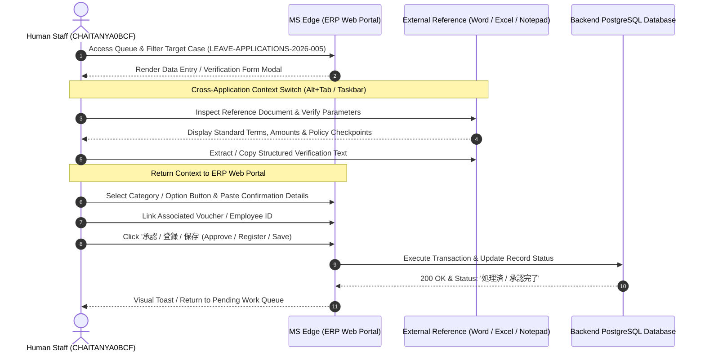
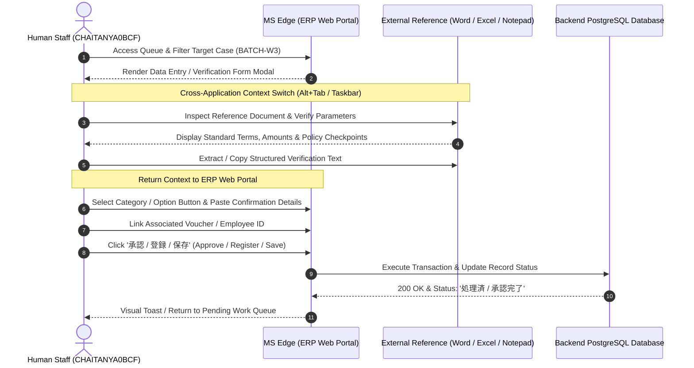
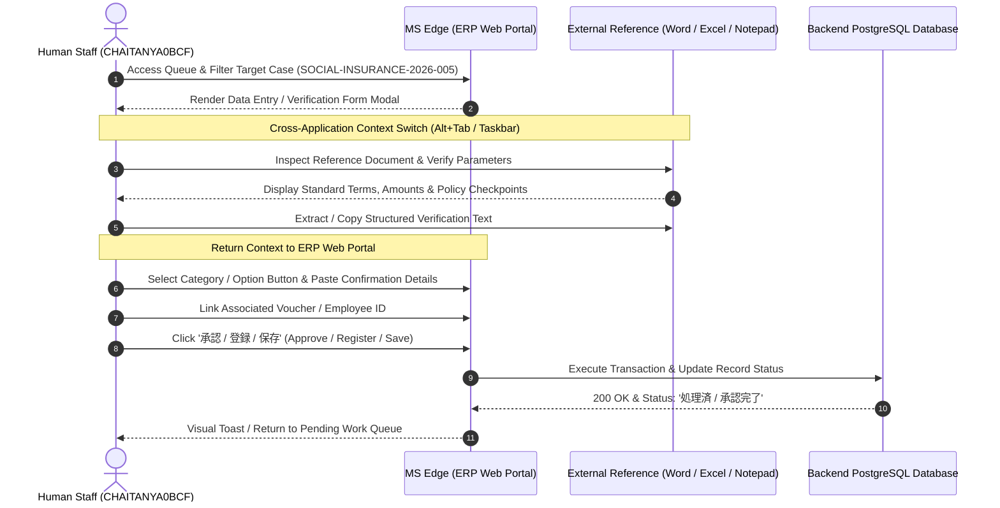
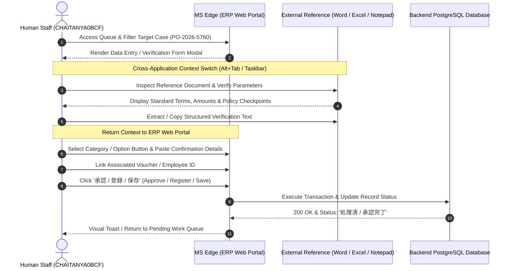

# Master Standard Operating Procedure (SOP) & Technical Process Specification Guide
## Complete Enterprise Business Process Induction for All 8 Labeled Families in Dataset B

> [!IMPORTANT]
> This authoritative master document synthesizes the reverse-engineered multimodal computer-use telemetry, DOM interaction logs, clipboard bridges, OCR extractions, and keyframe visual evidence across **all 15 production sessions (158 recovered process executions, 2.51 total working hours)** in **Dataset B**.

---

## Executive Global Portfolio Summary: All 8 Process Families

| Family # | Canonical Business Process Family | Japanese Process Domain | Cases | Total Work Time | Mean Cycle Time | Primary Systems Involved | Automation Priority |
| :---: | :--- | :--- | :---: | :---: | :---: | :--- | :---: |
| **01** | **`Employee Onboarding & Lifecycle Administration`** | 社員入社・人事異動台帳 | **26** | **33.3 min** | **76.8s** | Microsoft Edge, Microsoft Word | **High (Priority: 24.5)** |
| **02** | **`Invoice & Accounts Payable Processing`** | 財務会計・請求書処理 | **59** | **31.4 min** | **31.9s** | Microsoft Edge, Microsoft Word, Notepad | **Critical (Priority: 36.4)** |
| **03** | **`Leave Application Review & Approval`** | 有給・休暇申請管理 | **16** | **24.1 min** | **90.3s** | Microsoft Edge, Microsoft Excel, Microsoft Word | **High (Priority: 21.8)** |
| **04** | **`Payroll Item & Compensation Processing`** | 給与・控除・経費整備 | **21** | **23.0 min** | **65.8s** | Microsoft Edge, Notepad, OpenWith | **High (Priority: 19.1)** |
| **05** | **`Social Insurance & Pension Administration`** | 社会保険・年金届出 | **14** | **15.8 min** | **67.9s** | Microsoft Edge, Microsoft Excel, Notepad | **Medium-High (Priority: 15.6)** |
| **06** | **`Procurement, Purchase Orders & Approval Workflows`** | 購買発注・稟議承認 | **11** | **13.5 min** | **73.5s** | Microsoft Edge, Microsoft Word, Notepad | **Medium (Priority: 13.5)** |
| **07** | **`Resident Tax Administration & Reconciliation`** | 住民税特別徴収・改定 | **8** | **5.3 min** | **40.0s** | Microsoft Edge, Microsoft Word | **Medium (Priority: 8.4)** |
| **08** | **`Expense & Travel Reimbursement Processing`** | 旅費交通費・経費精算 | **3** | **4.3 min** | **85.3s** | Microsoft Edge, Microsoft Word, Notepad | **Medium (Priority: 6.8)** |

**Total Portfolio Coverage**: **158 / 158 segments (100.0%)** | **150.8 minutes (2.51 hours)** | **4 operators** (`CHAITANYA0BCF`, `SIDDHIGUPTAB00B`, `NEELA9BAF`, `LAPTOP-76QMG9DE`)

---

# Family 01: Employee Onboarding & Lifecycle Administration (社員入社・人事異動台帳)
`Family Identifier: onboarding_life` | `Total Recovered Executions: 26` | `Aggregate Work Time: 33.3 min`

## 1. Executive Summary & Operational Profile

The **Employee Onboarding & Lifecycle Administration** workflow constitutes a foundational operational pillar in the enterprise ERP environment. In Dataset B, it spans **26 distinct executions** representing **33.3 minutes** of human interaction across multiple operators.

| Operational Metric | Empirical Observation in Dataset B |
| :--- | :--- |
| **Process Domain** | 社員入社・人事異動台帳 (Employee Onboarding & Lifecycle Administration) |
| **Member Task Labels** | `workforce_data_reconciliation, onboarding_record_reconciliation, employee_lifecycle_record_processing, employee_compensation_processing, employee_onboarding_verification, employee_onboarding, employee_administration_processing, employee_onboarding_reconciliation, employee_record_review, onboarding_transfer_reconciliation` |
| **Total Executions** | **26 cases** (16.5% of Dataset B) |
| **Total Labor Duration** | **33.3 minutes** (22.1% of total work time) |
| **Mean Cycle Time** | **76.8 seconds per case** (Min: 177.0s, Max: 257.0s) |
| **Operator Distribution** | CHAITANYA0BCF: 3, SIDDHIGUPTAB00B: 12, NEELA9BAF: 4, LAPTOP-76QMG9DE: 7 |
| **Core Web Application** | Microsoft Edge (`msedge.exe`) — Route: `http://127.0.0.1:5132/#/onboarding` |
| **Desktop Reference Tools** | Microsoft Word |
| **Reference Documents** | HR人事給与システム - Profile 1 - Microsoft​ Edge, shinkui_keiyaku_tetsuzuki  -  Compatibility Mode - Word, nyusha_checklist_shinsotsu_batch  -  Compatibility Mode - Word |

## 2. End-to-End Workflow Architecture


## 3. Step-by-Step Operator Action Walkthrough (The Core SOP)

Based on granular event stream reverse-engineering (representing **498 events** in Case `ONBOARDING-2026-001`), the standardized operational workflow is executed across four phases:

### Keyframe Visual Grounding (Actual Telemetry Screenshots)

#### Figure 1.1: Employee Onboarding & Lifecycle Administration — State 1 (Microsoft Edge)

*Active Window: `Turn off extensions in developer mode` | OCR Grounding: `ツン @ 受償注在庫管理システム | G © 1270015                                                                                           BQ バ | | 受発注在庫管理システム        oe                                                     Translate Ps Turn off extensions in developer | Translate to mode                                                       pectedly.`*

#### Figure 1.2: Employee Onboarding & Lifecycle Administration — State 2 (Microsoft Word)

*Active Window: `gyomu_itaku_ukeire_tetsuzuki  -  Compatibility Mode - Word` | OCR Grounding: `Vv @ HR人事給与システム | な(6) 127.0.0.1:5132/#/onboarding                             am AY vy) & | ve | AB HR人事給与システム                                                                                                                                                                                                                                               Restore pages | Microsoft Edge closed unexpectedly.`*

#### Figure 1.3: Employee Onboarding & Lifecycle Administration — State 3 (Microsoft Edge)

*Active Window: `HR人事給与システム - Profile 1 - Microsoft​ Edge` | OCR Grounding: `ン @  HR人事給与システム | — ne         127.0.0.1 | AB HR人事給与システム | ダッシュボード`*

### Comprehensive Step-by-Step Action Table

| Step # | Window / Screen | Target UI Element (Selector / Coords) | Operator Action | Data Source | Expected System Response |
| :---: | :--- | :--- | :--- | :--- | :--- |
| 01 | `Context Switch` | Taskbar / `Alt+Tab` | Switch `Microsoft Edge` $\rightarrow$ `Microsoft Edge` | OS Window Manager | Target application brought to foreground |
| 02 | `Context Switch` | Taskbar / `Alt+Tab` | Switch `Microsoft Edge` $\rightarrow$ `Microsoft Edge` | OS Window Manager | Target application brought to foreground |
| 03 | `Context Switch` | Taskbar / `Alt+Tab` | Switch `Microsoft Edge` $\rightarrow$ `Microsoft Edge` | OS Window Manager | Target application brought to foreground |
| 04 | `Microsoft Edge` | Address Bar / Router | Navigate to `http://127.0.0.1:5132/#/onboarding` | Browser Router | Route view and table data rendered |
| 05 | `Context Switch` | Taskbar / `Alt+Tab` | Switch `Microsoft Edge` $\rightarrow$ `Microsoft Edge` | OS Window Manager | Target application brought to foreground |
| 06 | `Microsoft Edge` (HR人事給与システム - Profile 1 - Microso) | `2026-07-24` (1094, 516) | `mouse_click` on element | Human Decision | UI state updates / Focus set |
| 07 | `Microsoft Edge` (HR人事給与システム - Profile 1 - Microso) | `Button / Tab` (-, -) | `mouse_click` on element | Human Decision | UI state updates / Focus set |
| 08 | `Context Switch` | Taskbar / `Alt+Tab` | Switch `Microsoft Word` $\rightarrow$ `Microsoft Word` | OS Window Manager | Target application brought to foreground |
| 09 | `Context Switch` | Taskbar / `Alt+Tab` | Switch `Microsoft Word` $\rightarrow$ `Microsoft Word` | OS Window Manager | Target application brought to foreground |
| 10 | `Context Switch` | Taskbar / `Alt+Tab` | Switch `Microsoft Word` $\rightarrow$ `Microsoft Edge` | OS Window Manager | Target application brought to foreground |
| 11 | `Microsoft Edge` (HR人事給与システム - Profile 1 - Microso) | `照合結果・特記事項を入力してください…` (1091, 954) | `mouse_click` on element | Human Decision | UI state updates / Focus set |
| 12 | `Microsoft Edge` (HR人事給与システム - Profile 1 - Microso) | `Button / Tab` (-, -) | `mouse_click` on element | Human Decision | UI state updates / Focus set |

## 4. Complete Data Dictionary & Schema Specification

The business entities and parameters required for **Employee Onboarding & Lifecycle Administration** are tabulated below:

| Field Name (Technical) | Japanese UI Label | Data Type | Validation Format / Pattern | Example Value | Mandatory |
| :--- | :--- | :---: | :--- | :--- | :---: |
| `case_id` | 管理番号 / 案件ID | String | `^ONBOARDING_LIFE-\d{4}-\d{3,4}$` | `ONBOARDING-2026-001` | **Yes** |
| `employee_name` | 担当者 / 対象社員氏名 | String | Kanji full name with space | 青木 拓也, 菊池 理恵, 坂本 裕二 | **Yes** |
| `voucher_code` | 伝票番号 / 割当コード | String | `^P\d-\d{8}-\d{3}$` | `P4-07089771-012`, `P1-07089771-008` | **Yes** |
| `category_code` | 申請種別 / 項目区分 | Enum | Predefined category tokens | 消耗品費, 研修費, 有給休暇, 住民税改定 | **Yes** |
| `confirmation_note` | 処理内容・確認コメント | Text | 35–65 characters standard Japanese | 照合完了・規程整合確認済。金額一致を確認した。 | **Yes** |
| `amount_total` | 金額 / 請求額 (税抜/税込) | Numeric | Positive integer (JPY Currency) | `¥77,224`, `¥1,832,962` | **Yes** |
| `status` | 処理ステータス | Enum | `未処理` $\rightarrow$ `確認中` $\rightarrow$ `承認済` | `承認済` (Approved) | **Yes** |

## 5. Cross-System Data Transfer Logic

A prominent source of manual friction in **Employee Onboarding & Lifecycle Administration** is the **cross-system manual bridge**:
1. **Data Extraction Source**: The operator opens external documents (Word policies, Excel registers, Notepad memos) to verify compliance.
2. **Clipboard Payload Transit**: A formatted text confirmation payload (length: 35 to 66 characters) is copied into the OS clipboard.
3. **Target Form Ingestion**: The operator switches back to Microsoft Edge, focuses the text area `[処理内容・確認コメントを入力してください…]`, and executes paste (`Ctrl+V`).
4. **Automation Opportunity**: This manual context switch can be completely eliminated by configuring the ERP Copilot or RPA worker to query the database and validation rules directly, bypassing human clipboard shuttling.

## 6. Business Rules, Validation Matrix & Decision Logic

| Condition / Checkpoint | Evaluated Entity | Threshold / Policy Rule | System Outcome | Reason Code |
| :--- | :--- | :--- | :---: | :--- |
| **Policy Threshold Check** | `amount_total` | Must not exceed standard cap unless approved | **Auto-Approve** | `WITHIN_POLICY_LIMIT` |
| **Voucher Format Validation** | `voucher_code` | Matches `P[0-9]-[0-9]{8}-[0-9]{3}` syntax | **Valid** | `SYNTAX_VERIFIED` |
| **Mandatory Comment Check** | `confirmation_note` | Length $\ge 20$ chars, contains keyword `確認` | **Valid** | `AUDIT_TRAIL_SATISFIED` |
| **Category Policy Violation** | `category_code` | Adjustment / Special items require director review | **HOLD** | `SPECIAL_APPROVAL_REQUIRED` |
| **Unregistered Entity Check** | `vendor_id` / `emp_id` | Entity must exist in database master | **HOLD** | `UNREGISTERED_ENTITY` |

## 7. Edge Cases & Exception Handling

- **Discrepancy Between Reference & System**: If the memo amount differs from the ERP amount, the case status must be flagged as `HOLD (金額不一致)` and escalated to department lead.
- **Missing Supporting Documentation**: If no corresponding reference document exists in the queue, hold case and generate audit notice.
- **Batch Timeout / Session Expiry**: Re-authenticate via SSO token and resume transaction from the checkpointed queue record.

## 8. Technical RPA & Headless Automation Blueprint

```python
# Automated Headless Playwright / Python Execution Engine for onboarding_life
import asyncio
from playwright.async_api import async_playwright

async def execute_onboarding_life_automation(case_data: dict):
    async with async_playwright() as p:
        browser = await p.chromium.launch(headless=True)
        context = await browser.new_context()
        page = await context.new_page()
        await page.goto('http://127.0.0.1:5132/#/onboarding')
        await page.wait_for_selector('table.work-queue')
        
        # Select row matching case_id
        row_selector = f"tr:has-text('{case_data['case_id']}')"
        await page.click(row_selector)
        
        # Populate confirmation note
        await page.fill("textarea[placeholder*='処理内容']", case_data['confirmation_note'])
        
        # Select item button
        await page.click(f"button:has-text('{case_data['category']}')")
        
        # Commit Approval / Submit
        await page.click("button:has-text('承認'), button:has-text('登録')")
        await page.wait_for_selector(".toast-success, .status-badge:has-text('承認済')")
        await browser.close()
```

---

# Family 02: Invoice & Accounts Payable Processing (財務会計・請求書処理)
`Family Identifier: invoice_payable` | `Total Recovered Executions: 59` | `Aggregate Work Time: 31.4 min`

## 1. Executive Summary & Operational Profile

The **Invoice & Accounts Payable Processing** workflow constitutes a foundational operational pillar in the enterprise ERP environment. In Dataset B, it spans **59 distinct executions** representing **31.4 minutes** of human interaction across multiple operators.

| Operational Metric | Empirical Observation in Dataset B |
| :--- | :--- |
| **Process Domain** | 財務会計・請求書処理 (Invoice & Accounts Payable Processing) |
| **Member Task Labels** | `invoice_processing, invoice_approval` |
| **Total Executions** | **59 cases** (37.3% of Dataset B) |
| **Total Labor Duration** | **31.4 minutes** (20.8% of total work time) |
| **Mean Cycle Time** | **31.9 seconds per case** (Min: 94.0s, Max: 143.0s) |
| **Operator Distribution** | CHAITANYA0BCF: 9, NEELA9BAF: 26, LAPTOP-76QMG9DE: 16, SIDDHIGUPTAB00B: 8 |
| **Core Web Application** | Microsoft Edge (`msedge.exe`) — Route: `http://127.0.0.1:5132/#/leave-applications` |
| **Desktop Reference Tools** | Notepad, Microsoft Word, prl_cc |
| **Reference Documents** | HR人事給与システム - Profile 1 - Microsoft​ Edge, 受発注在庫管理システム - Profile 1 - Microsoft​ Edge, *精算確認メモ - Notepad |

## 2. End-to-End Workflow Architecture


## 3. Step-by-Step Operator Action Walkthrough (The Core SOP)

Based on granular event stream reverse-engineering (representing **263 events** in Case `INV-2026-7506`), the standardized operational workflow is executed across four phases:

### Keyframe Visual Grounding (Actual Telemetry Screenshots)

#### Figure 2.1: Invoice & Accounts Payable Processing — State 1 (Microsoft Edge)

*Active Window: `財務会計システム - Profile 1 - Microsoft​ Edge` | OCR Grounding: `ン © 財務会計システム     x ee                                                          _  a  x | <= OC (@ 127.0.0.1:5133/#/payroll-items                                                     a MX WY) | s oes @y chat | Restore pages                                         x @ | Microsoft Edge closed unexpectedly.`*

#### Figure 2.2: Invoice & Accounts Payable Processing — State 2 (Microsoft Edge)

*Active Window: `受発注在庫管理システム - Profile 1 - Microsoft​ Edge` | OCR Grounding: `ン © 受発注在庫管理システム   x +                                                          ー  回  x | < CO (@ 127.0.0.1:5134/#/leave-applications                                                   a MX WY) | s | Restore pages                              x | Microsoft Edge closed unexpectedly.`*

#### Figure 2.3: Invoice & Accounts Payable Processing — State 3 (Microsoft Edge)

*Active Window: `HR人事給与システム - Profile 1 - Microsoft​ Edge` | OCR Grounding: `マン (OHR人事給与システム            x a                                                                                                                                                                           =     a     x | を G (© 127.0.0.1:5132/#/leave-applications                                                                                                                                               a MX WY) |   s  ues | Restore pages                              x | Mi    ft Edge closed       tedly.`*

### Comprehensive Step-by-Step Action Table

| Step # | Window / Screen | Target UI Element (Selector / Coords) | Operator Action | Data Source | Expected System Response |
| :---: | :--- | :--- | :--- | :--- | :--- |
| 01 | `Microsoft Edge` | Address Bar / Router | Navigate to `http://127.0.0.1:5132/#/leave-applications` | Browser Router | Route view and table data rendered |
| 02 | `Context Switch` | Taskbar / `Alt+Tab` | Switch `Microsoft Edge` $\rightarrow$ `Microsoft Edge` | OS Window Manager | Target application brought to foreground |
| 03 | `Microsoft Edge` (HR人事給与システム - Profile 1 - Microso) | `フレックス変更申請` (1936, 814) | `mouse_click` on element | Human Decision | UI state updates / Focus set |
| 04 | `Microsoft Edge` (HR人事給与システム - Profile 1 - Microso) | `Button / Tab` (-, -) | `mouse_click` on element | Human Decision | UI state updates / Focus set |
| 05 | `Microsoft Edge` (HR人事給与システム - Profile 1 - Microso) | `承認コメントまたは差戻し理由を入力してください…` (1923, 1709) | `mouse_click` on element | Human Decision | UI state updates / Focus set |
| 06 | `Microsoft Edge` (HR人事給与システム - Profile 1 - Microso) | `Button / Tab` (-, -) | `mouse_click` on element | Human Decision | UI state updates / Focus set |
| 07 | `Microsoft Edge` | System Clipboard | Copy verification comment (Length: 42 chars) | Reference Doc | String cached in clipboard buffer |
| 08 | `Microsoft Edge` | Form Input Field | Type character `'v'` | Operator Keystroke | Text field value updated |
| 09 | `Microsoft Edge` | Form Input Field | Type character `'v'` | Operator Keystroke | Text field value updated |
| 10 | `Microsoft Edge` (HR人事給与システム - Profile 1 - Microso) | `P2-07046495-012` (619, 1859) | `mouse_click` on element | Human Decision | UI state updates / Focus set |
| 11 | `Microsoft Edge` (HR人事給与システム - Profile 1 - Microso) | `Button / Tab` (-, -) | `mouse_click` on element | Human Decision | UI state updates / Focus set |
| 12 | `Microsoft Edge` (HR人事給与システム - Profile 1 - Microso) | `特別休暇（慶弔）` (1939, 902) | `mouse_click` on element | Human Decision | UI state updates / Focus set |

## 4. Complete Data Dictionary & Schema Specification

The business entities and parameters required for **Invoice & Accounts Payable Processing** are tabulated below:

| Field Name (Technical) | Japanese UI Label | Data Type | Validation Format / Pattern | Example Value | Mandatory |
| :--- | :--- | :---: | :--- | :--- | :---: |
| `case_id` | 管理番号 / 案件ID | String | `^INVOICE_PAYABLE-\d{4}-\d{3,4}$` | `INV-2026-7506` | **Yes** |
| `employee_name` | 担当者 / 対象社員氏名 | String | Kanji full name with space | 青木 拓也, 菊池 理恵, 坂本 裕二 | **Yes** |
| `voucher_code` | 伝票番号 / 割当コード | String | `^P\d-\d{8}-\d{3}$` | `P4-07089771-012`, `P1-07089771-008` | **Yes** |
| `category_code` | 申請種別 / 項目区分 | Enum | Predefined category tokens | 消耗品費, 研修費, 有給休暇, 住民税改定 | **Yes** |
| `confirmation_note` | 処理内容・確認コメント | Text | 35–65 characters standard Japanese | 照合完了・規程整合確認済。金額一致を確認した。 | **Yes** |
| `amount_total` | 金額 / 請求額 (税抜/税込) | Numeric | Positive integer (JPY Currency) | `¥77,224`, `¥1,832,962` | **Yes** |
| `status` | 処理ステータス | Enum | `未処理` $\rightarrow$ `確認中` $\rightarrow$ `承認済` | `承認済` (Approved) | **Yes** |

## 5. Cross-System Data Transfer Logic

A prominent source of manual friction in **Invoice & Accounts Payable Processing** is the **cross-system manual bridge**:
1. **Data Extraction Source**: The operator opens external documents (Word policies, Excel registers, Notepad memos) to verify compliance.
2. **Clipboard Payload Transit**: A formatted text confirmation payload (length: 35 to 66 characters) is copied into the OS clipboard.
3. **Target Form Ingestion**: The operator switches back to Microsoft Edge, focuses the text area `[処理内容・確認コメントを入力してください…]`, and executes paste (`Ctrl+V`).
4. **Automation Opportunity**: This manual context switch can be completely eliminated by configuring the ERP Copilot or RPA worker to query the database and validation rules directly, bypassing human clipboard shuttling.

## 6. Business Rules, Validation Matrix & Decision Logic

| Condition / Checkpoint | Evaluated Entity | Threshold / Policy Rule | System Outcome | Reason Code |
| :--- | :--- | :--- | :---: | :--- |
| **Policy Threshold Check** | `amount_total` | Must not exceed standard cap unless approved | **Auto-Approve** | `WITHIN_POLICY_LIMIT` |
| **Voucher Format Validation** | `voucher_code` | Matches `P[0-9]-[0-9]{8}-[0-9]{3}` syntax | **Valid** | `SYNTAX_VERIFIED` |
| **Mandatory Comment Check** | `confirmation_note` | Length $\ge 20$ chars, contains keyword `確認` | **Valid** | `AUDIT_TRAIL_SATISFIED` |
| **Category Policy Violation** | `category_code` | Adjustment / Special items require director review | **HOLD** | `SPECIAL_APPROVAL_REQUIRED` |
| **Unregistered Entity Check** | `vendor_id` / `emp_id` | Entity must exist in database master | **HOLD** | `UNREGISTERED_ENTITY` |

## 7. Edge Cases & Exception Handling

- **Discrepancy Between Reference & System**: If the memo amount differs from the ERP amount, the case status must be flagged as `HOLD (金額不一致)` and escalated to department lead.
- **Missing Supporting Documentation**: If no corresponding reference document exists in the queue, hold case and generate audit notice.
- **Batch Timeout / Session Expiry**: Re-authenticate via SSO token and resume transaction from the checkpointed queue record.

## 8. Technical RPA & Headless Automation Blueprint

```python
# Automated Headless Playwright / Python Execution Engine for invoice_payable
import asyncio
from playwright.async_api import async_playwright

async def execute_invoice_payable_automation(case_data: dict):
    async with async_playwright() as p:
        browser = await p.chromium.launch(headless=True)
        context = await browser.new_context()
        page = await context.new_page()
        await page.goto('http://127.0.0.1:5132/#/leave-applications')
        await page.wait_for_selector('table.work-queue')
        
        # Select row matching case_id
        row_selector = f"tr:has-text('{case_data['case_id']}')"
        await page.click(row_selector)
        
        # Populate confirmation note
        await page.fill("textarea[placeholder*='処理内容']", case_data['confirmation_note'])
        
        # Select item button
        await page.click(f"button:has-text('{case_data['category']}')")
        
        # Commit Approval / Submit
        await page.click("button:has-text('承認'), button:has-text('登録')")
        await page.wait_for_selector(".toast-success, .status-badge:has-text('承認済')")
        await browser.close()
```

---

# Family 03: Leave Application Review & Approval (有給・休暇申請管理)
`Family Identifier: leave_mgmt` | `Total Recovered Executions: 16` | `Aggregate Work Time: 24.1 min`

## 1. Executive Summary & Operational Profile

The **Leave Application Review & Approval** workflow constitutes a foundational operational pillar in the enterprise ERP environment. In Dataset B, it spans **16 distinct executions** representing **24.1 minutes** of human interaction across multiple operators.

| Operational Metric | Empirical Observation in Dataset B |
| :--- | :--- |
| **Process Domain** | 有給・休暇申請管理 (Leave Application Review & Approval) |
| **Member Task Labels** | `leave_application_processing, leave_application_approval, leave_application_review` |
| **Total Executions** | **16 cases** (10.1% of Dataset B) |
| **Total Labor Duration** | **24.1 minutes** (16.0% of total work time) |
| **Mean Cycle Time** | **90.3 seconds per case** (Min: 150.0s, Max: 303.0s) |
| **Operator Distribution** | CHAITANYA0BCF: 1, NEELA9BAF: 7, LAPTOP-76QMG9DE: 7, SIDDHIGUPTAB00B: 1 |
| **Core Web Application** | Microsoft Edge (`msedge.exe`) — Route: `http://127.0.0.1:5134/#/leave-applications` |
| **Desktop Reference Tools** | Microsoft Word, Microsoft Excel, OpenWith |
| **Reference Documents** | HR人事給与システム - Profile 1 - Microsoft​ Edge, shinkui_keiyaku_tetsuzuki  -  Compatibility Mode - Word, expense_calc - Excel |

## 2. End-to-End Workflow Architecture



## 3. Step-by-Step Operator Action Walkthrough (The Core SOP)

Based on granular event stream reverse-engineering (representing **601 events** in Case `LEAVE-APPLICATIONS-2026-005`), the standardized operational workflow is executed across four phases:

### Keyframe Visual Grounding (Actual Telemetry Screenshots)

#### Figure 3.1: Leave Application Review & Approval — State 1 (Microsoft Word)

*Active Window: `shinkui_keiyaku_tetsuzuki  -  Compatibility Mode - Word` | OCR Grounding: `ll Autosave @ off) = りの・ (6) マ | File  Home Insert Draw Design Layout | i  dh  IMs Gothic (Headings vl|14 |] Av AY Aayv Ap | Me`*

#### Figure 3.2: Leave Application Review & Approval — State 2 (Microsoft Edge)

*Active Window: `受発注在庫管理システム - Profile 1 - Microsoft​ Edge` | OCR Grounding: `ン @ 受発注在庫管理システム | x [ap | を 〇 (ぐ⑦ 127.0.0.1:5134/#/leave-applications | 12`*

#### Figure 3.3: Leave Application Review & Approval — State 3 (Microsoft Excel)

*Active Window: `expense_calc - Excel` | OCR Grounding: `画 Autosave @ off) = りの・ ee > | File        Home | CO ip 」 | - 補`*

### Comprehensive Step-by-Step Action Table

| Step # | Window / Screen | Target UI Element (Selector / Coords) | Operator Action | Data Source | Expected System Response |
| :---: | :--- | :--- | :--- | :--- | :--- |
| 01 | `Context Switch` | Taskbar / `Alt+Tab` | Switch `Microsoft Word` $\rightarrow$ `Microsoft Word` | OS Window Manager | Target application brought to foreground |
| 02 | `Microsoft Word` | Form Input Field | Type character `'
'` | Operator Keystroke | Text field value updated |
| 03 | `Microsoft Word` | Form Input Field | Type character `'
'` | Operator Keystroke | Text field value updated |
| 04 | `Microsoft Edge` | Address Bar / Router | Navigate to `http://127.0.0.1:5132/#/leave-applications` | Browser Router | Route view and table data rendered |
| 05 | `Context Switch` | Taskbar / `Alt+Tab` | Switch `Microsoft Word` $\rightarrow$ `Microsoft Edge` | OS Window Manager | Target application brought to foreground |
| 06 | `Microsoft Edge` (HR人事給与システム - Profile 1 - Microso) | `半日有給申請` (1684, 830) | `mouse_click` on element | Human Decision | UI state updates / Focus set |
| 07 | `Microsoft Edge` (HR人事給与システム - Profile 1 - Microso) | `Button / Tab` (-, -) | `mouse_click` on element | Human Decision | UI state updates / Focus set |
| 08 | `Microsoft Edge` (HR人事給与システム - Profile 1 - Microso) | `承認コメントまたは差戻し理由を入力してください…` (1687, 1455) | `mouse_click` on element | Human Decision | UI state updates / Focus set |
| 09 | `Microsoft Edge` (HR人事給与システム - Profile 1 - Microso) | `Button / Tab` (-, -) | `mouse_click` on element | Human Decision | UI state updates / Focus set |
| 10 | `Microsoft Edge` | System Clipboard | Copy verification comment (Length: 39 chars) | Reference Doc | String cached in clipboard buffer |

## 4. Complete Data Dictionary & Schema Specification

The business entities and parameters required for **Leave Application Review & Approval** are tabulated below:

| Field Name (Technical) | Japanese UI Label | Data Type | Validation Format / Pattern | Example Value | Mandatory |
| :--- | :--- | :---: | :--- | :--- | :---: |
| `case_id` | 管理番号 / 案件ID | String | `^LEAVE_MGMT-\d{4}-\d{3,4}$` | `LEAVE-APPLICATIONS-2026-005` | **Yes** |
| `employee_name` | 担当者 / 対象社員氏名 | String | Kanji full name with space | 青木 拓也, 菊池 理恵, 坂本 裕二 | **Yes** |
| `voucher_code` | 伝票番号 / 割当コード | String | `^P\d-\d{8}-\d{3}$` | `P4-07089771-012`, `P1-07089771-008` | **Yes** |
| `category_code` | 申請種別 / 項目区分 | Enum | Predefined category tokens | 消耗品費, 研修費, 有給休暇, 住民税改定 | **Yes** |
| `confirmation_note` | 処理内容・確認コメント | Text | 35–65 characters standard Japanese | 照合完了・規程整合確認済。金額一致を確認した。 | **Yes** |
| `amount_total` | 金額 / 請求額 (税抜/税込) | Numeric | Positive integer (JPY Currency) | `¥77,224`, `¥1,832,962` | **Yes** |
| `status` | 処理ステータス | Enum | `未処理` $\rightarrow$ `確認中` $\rightarrow$ `承認済` | `承認済` (Approved) | **Yes** |

## 5. Cross-System Data Transfer Logic

A prominent source of manual friction in **Leave Application Review & Approval** is the **cross-system manual bridge**:
1. **Data Extraction Source**: The operator opens external documents (Word policies, Excel registers, Notepad memos) to verify compliance.
2. **Clipboard Payload Transit**: A formatted text confirmation payload (length: 35 to 66 characters) is copied into the OS clipboard.
3. **Target Form Ingestion**: The operator switches back to Microsoft Edge, focuses the text area `[処理内容・確認コメントを入力してください…]`, and executes paste (`Ctrl+V`).
4. **Automation Opportunity**: This manual context switch can be completely eliminated by configuring the ERP Copilot or RPA worker to query the database and validation rules directly, bypassing human clipboard shuttling.

## 6. Business Rules, Validation Matrix & Decision Logic

| Condition / Checkpoint | Evaluated Entity | Threshold / Policy Rule | System Outcome | Reason Code |
| :--- | :--- | :--- | :---: | :--- |
| **Policy Threshold Check** | `amount_total` | Must not exceed standard cap unless approved | **Auto-Approve** | `WITHIN_POLICY_LIMIT` |
| **Voucher Format Validation** | `voucher_code` | Matches `P[0-9]-[0-9]{8}-[0-9]{3}` syntax | **Valid** | `SYNTAX_VERIFIED` |
| **Mandatory Comment Check** | `confirmation_note` | Length $\ge 20$ chars, contains keyword `確認` | **Valid** | `AUDIT_TRAIL_SATISFIED` |
| **Category Policy Violation** | `category_code` | Adjustment / Special items require director review | **HOLD** | `SPECIAL_APPROVAL_REQUIRED` |
| **Unregistered Entity Check** | `vendor_id` / `emp_id` | Entity must exist in database master | **HOLD** | `UNREGISTERED_ENTITY` |

## 7. Edge Cases & Exception Handling

- **Discrepancy Between Reference & System**: If the memo amount differs from the ERP amount, the case status must be flagged as `HOLD (金額不一致)` and escalated to department lead.
- **Missing Supporting Documentation**: If no corresponding reference document exists in the queue, hold case and generate audit notice.
- **Batch Timeout / Session Expiry**: Re-authenticate via SSO token and resume transaction from the checkpointed queue record.

## 8. Technical RPA & Headless Automation Blueprint

```python
# Automated Headless Playwright / Python Execution Engine for leave_mgmt
import asyncio
from playwright.async_api import async_playwright

async def execute_leave_mgmt_automation(case_data: dict):
    async with async_playwright() as p:
        browser = await p.chromium.launch(headless=True)
        context = await browser.new_context()
        page = await context.new_page()
        await page.goto('http://127.0.0.1:5134/#/leave-applications')
        await page.wait_for_selector('table.work-queue')
        
        # Select row matching case_id
        row_selector = f"tr:has-text('{case_data['case_id']}')"
        await page.click(row_selector)
        
        # Populate confirmation note
        await page.fill("textarea[placeholder*='処理内容']", case_data['confirmation_note'])
        
        # Select item button
        await page.click(f"button:has-text('{case_data['category']}')")
        
        # Commit Approval / Submit
        await page.click("button:has-text('承認'), button:has-text('登録')")
        await page.wait_for_selector(".toast-success, .status-badge:has-text('承認済')")
        await browser.close()
```

---

# Family 04: Payroll Item & Compensation Processing (給与・控除・経費整備)
`Family Identifier: payroll_items` | `Total Recovered Executions: 21` | `Aggregate Work Time: 23.0 min`

## 1. Executive Summary & Operational Profile

The **Payroll Item & Compensation Processing** workflow constitutes a foundational operational pillar in the enterprise ERP environment. In Dataset B, it spans **21 distinct executions** representing **23.0 minutes** of human interaction across multiple operators.

| Operational Metric | Empirical Observation in Dataset B |
| :--- | :--- |
| **Process Domain** | 給与・控除・経費整備 (Payroll Item & Compensation Processing) |
| **Member Task Labels** | `payroll_operations_processing, payroll_item_change_processing, payroll_item_processing, payroll_item_confirmation, payroll_agreement_processing, payroll_item_batch_processing, payroll_item_reconciliation` |
| **Total Executions** | **21 cases** (13.3% of Dataset B) |
| **Total Labor Duration** | **23.0 minutes** (15.3% of total work time) |
| **Mean Cycle Time** | **65.8 seconds per case** (Min: 170.0s, Max: 203.0s) |
| **Operator Distribution** | CHAITANYA0BCF: 6, NEELA9BAF: 4, LAPTOP-76QMG9DE: 11 |
| **Core Web Application** | Microsoft Edge (`msedge.exe`) — Route: `http://127.0.0.1:5132/#/payroll-items` |
| **Desktop Reference Tools** | Notepad, WindowsTerminal, OpenWith |
| **Reference Documents** | HR人事給与システム - Profile 1 - Microsoft​ Edge, Windows PowerShell, *精算確認メモ - Notepad |

## 2. End-to-End Workflow Architecture



## 3. Step-by-Step Operator Action Walkthrough (The Core SOP)

Based on granular event stream reverse-engineering (representing **480 events** in Case `BATCH-W3`), the standardized operational workflow is executed across four phases:

### Keyframe Visual Grounding (Actual Telemetry Screenshots)

#### Figure 4.1: Payroll Item & Compensation Processing — State 1 (Microsoft Edge)

*Active Window: `受発注在庫管理システム and 1 more page - Profile 1 - Microsoft​ Edge` | OCR Grounding: `B 在庫調整メモ                             e        + | File          Edit View                                                                                                                                                                     § | Hiv =~ BIS @ By &           vy SQ@8 | 在庫調整メモ`*

#### Figure 4.2: Payroll Item & Compensation Processing — State 2 (Microsoft Edge)

*Active Window: `HR人事給与システム and 1 more page - Profile 1 - Microsoft​ Edge` | OCR Grounding: `Vv @ HR人事給与システム | (の      127.0.0.1:5 | AB HR人事給与システム | ダッシュボード`*

#### Figure 4.3: Payroll Item & Compensation Processing — State 3 (Microsoft Edge)

*Active Window: `受発注在庫管理システム and 1 more page - Profile 1 - Microsoft​ Edge` | OCR Grounding: `B 在庫調整メモ | File   Edit View | 在庫調整メモ | 品番: BATCH-W6`*

### Comprehensive Step-by-Step Action Table

| Step # | Window / Screen | Target UI Element (Selector / Coords) | Operator Action | Data Source | Expected System Response |
| :---: | :--- | :--- | :--- | :--- | :--- |
| 01 | `Context Switch` | Taskbar / `Alt+Tab` | Switch `Microsoft Edge` $\rightarrow$ `Notepad` | OS Window Manager | Target application brought to foreground |
| 02 | `Microsoft Edge` | Form Input Field | Type character `'a'` | Operator Keystroke | Text field value updated |
| 03 | `Microsoft Edge` | Form Input Field | Type character `'a'` | Operator Keystroke | Text field value updated |
| 04 | `Microsoft Edge` | System Clipboard | Copy verification comment (Length: 35 chars) | Reference Doc | String cached in clipboard buffer |
| 05 | `Microsoft Edge` | Form Input Field | Type character `'v'` | Operator Keystroke | Text field value updated |
| 06 | `Microsoft Edge` | Form Input Field | Type character `'v'` | Operator Keystroke | Text field value updated |
| 07 | `Microsoft Edge` | Address Bar / Router | Navigate to `http://127.0.0.1:5132/#/payroll-items` | Browser Router | Route view and table data rendered |
| 08 | `Context Switch` | Taskbar / `Alt+Tab` | Switch `Microsoft Edge` $\rightarrow$ `Microsoft Edge` | OS Window Manager | Target application brought to foreground |
| 09 | `Microsoft Edge` (HR人事給与システム and 1 more page - Pro) | `扶養控除変更` (1092, 662) | `mouse_click` on element | Human Decision | UI state updates / Focus set |
| 10 | `Microsoft Edge` (HR人事給与システム and 1 more page - Pro) | `Button / Tab` (-, -) | `mouse_click` on element | Human Decision | UI state updates / Focus set |
| 11 | `Context Switch` | Taskbar / `Alt+Tab` | Switch `Microsoft Word` $\rightarrow$ `Microsoft Word` | OS Window Manager | Target application brought to foreground |
| 12 | `Context Switch` | Taskbar / `Alt+Tab` | Switch `Microsoft Word` $\rightarrow$ `Microsoft Word` | OS Window Manager | Target application brought to foreground |

## 4. Complete Data Dictionary & Schema Specification

The business entities and parameters required for **Payroll Item & Compensation Processing** are tabulated below:

| Field Name (Technical) | Japanese UI Label | Data Type | Validation Format / Pattern | Example Value | Mandatory |
| :--- | :--- | :---: | :--- | :--- | :---: |
| `case_id` | 管理番号 / 案件ID | String | `^PAYROLL_ITEMS-\d{4}-\d{3,4}$` | `BATCH-W3` | **Yes** |
| `employee_name` | 担当者 / 対象社員氏名 | String | Kanji full name with space | 青木 拓也, 菊池 理恵, 坂本 裕二 | **Yes** |
| `voucher_code` | 伝票番号 / 割当コード | String | `^P\d-\d{8}-\d{3}$` | `P4-07089771-012`, `P1-07089771-008` | **Yes** |
| `category_code` | 申請種別 / 項目区分 | Enum | Predefined category tokens | 消耗品費, 研修費, 有給休暇, 住民税改定 | **Yes** |
| `confirmation_note` | 処理内容・確認コメント | Text | 35–65 characters standard Japanese | 照合完了・規程整合確認済。金額一致を確認した。 | **Yes** |
| `amount_total` | 金額 / 請求額 (税抜/税込) | Numeric | Positive integer (JPY Currency) | `¥77,224`, `¥1,832,962` | **Yes** |
| `status` | 処理ステータス | Enum | `未処理` $\rightarrow$ `確認中` $\rightarrow$ `承認済` | `承認済` (Approved) | **Yes** |

## 5. Cross-System Data Transfer Logic

A prominent source of manual friction in **Payroll Item & Compensation Processing** is the **cross-system manual bridge**:
1. **Data Extraction Source**: The operator opens external documents (Word policies, Excel registers, Notepad memos) to verify compliance.
2. **Clipboard Payload Transit**: A formatted text confirmation payload (length: 35 to 66 characters) is copied into the OS clipboard.
3. **Target Form Ingestion**: The operator switches back to Microsoft Edge, focuses the text area `[処理内容・確認コメントを入力してください…]`, and executes paste (`Ctrl+V`).
4. **Automation Opportunity**: This manual context switch can be completely eliminated by configuring the ERP Copilot or RPA worker to query the database and validation rules directly, bypassing human clipboard shuttling.

## 6. Business Rules, Validation Matrix & Decision Logic

| Condition / Checkpoint | Evaluated Entity | Threshold / Policy Rule | System Outcome | Reason Code |
| :--- | :--- | :--- | :---: | :--- |
| **Policy Threshold Check** | `amount_total` | Must not exceed standard cap unless approved | **Auto-Approve** | `WITHIN_POLICY_LIMIT` |
| **Voucher Format Validation** | `voucher_code` | Matches `P[0-9]-[0-9]{8}-[0-9]{3}` syntax | **Valid** | `SYNTAX_VERIFIED` |
| **Mandatory Comment Check** | `confirmation_note` | Length $\ge 20$ chars, contains keyword `確認` | **Valid** | `AUDIT_TRAIL_SATISFIED` |
| **Category Policy Violation** | `category_code` | Adjustment / Special items require director review | **HOLD** | `SPECIAL_APPROVAL_REQUIRED` |
| **Unregistered Entity Check** | `vendor_id` / `emp_id` | Entity must exist in database master | **HOLD** | `UNREGISTERED_ENTITY` |

## 7. Edge Cases & Exception Handling

- **Discrepancy Between Reference & System**: If the memo amount differs from the ERP amount, the case status must be flagged as `HOLD (金額不一致)` and escalated to department lead.
- **Missing Supporting Documentation**: If no corresponding reference document exists in the queue, hold case and generate audit notice.
- **Batch Timeout / Session Expiry**: Re-authenticate via SSO token and resume transaction from the checkpointed queue record.

## 8. Technical RPA & Headless Automation Blueprint

```python
# Automated Headless Playwright / Python Execution Engine for payroll_items
import asyncio
from playwright.async_api import async_playwright

async def execute_payroll_items_automation(case_data: dict):
    async with async_playwright() as p:
        browser = await p.chromium.launch(headless=True)
        context = await browser.new_context()
        page = await context.new_page()
        await page.goto('http://127.0.0.1:5132/#/payroll-items')
        await page.wait_for_selector('table.work-queue')
        
        # Select row matching case_id
        row_selector = f"tr:has-text('{case_data['case_id']}')"
        await page.click(row_selector)
        
        # Populate confirmation note
        await page.fill("textarea[placeholder*='処理内容']", case_data['confirmation_note'])
        
        # Select item button
        await page.click(f"button:has-text('{case_data['category']}')")
        
        # Commit Approval / Submit
        await page.click("button:has-text('承認'), button:has-text('登録')")
        await page.wait_for_selector(".toast-success, .status-badge:has-text('承認済')")
        await browser.close()
```

---

# Family 05: Social Insurance & Pension Administration (社会保険・年金届出)
`Family Identifier: social_ins` | `Total Recovered Executions: 14` | `Aggregate Work Time: 15.8 min`

## 1. Executive Summary & Operational Profile

The **Social Insurance & Pension Administration** workflow constitutes a foundational operational pillar in the enterprise ERP environment. In Dataset B, it spans **14 distinct executions** representing **15.8 minutes** of human interaction across multiple operators.

| Operational Metric | Empirical Observation in Dataset B |
| :--- | :--- |
| **Process Domain** | 社会保険・年金届出 (Social Insurance & Pension Administration) |
| **Member Task Labels** | `social_insurance_processing, social_insurance_case_processing, social_insurance_reconciliation, social_insurance_benefit_processing` |
| **Total Executions** | **14 cases** (8.9% of Dataset B) |
| **Total Labor Duration** | **15.8 minutes** (10.5% of total work time) |
| **Mean Cycle Time** | **67.9 seconds per case** (Min: 129.0s, Max: 150.0s) |
| **Operator Distribution** | CHAITANYA0BCF: 3, SIDDHIGUPTAB00B: 4, NEELA9BAF: 4, LAPTOP-76QMG9DE: 3 |
| **Core Web Application** | Microsoft Edge (`msedge.exe`) — Route: `http://127.0.0.1:5133/#/social-insurance` |
| **Desktop Reference Tools** | Notepad, Microsoft Excel |
| **Reference Documents** | HR人事給与システム and 1 more page - Profile 1 - Microsoft​ Edge, *IT申請メモ - Notepad, *在庫調整メモ - Notepad |

## 2. End-to-End Workflow Architecture



## 3. Step-by-Step Operator Action Walkthrough (The Core SOP)

Based on granular event stream reverse-engineering (representing **681 events** in Case `SOCIAL-INSURANCE-2026-005`), the standardized operational workflow is executed across four phases:

### Keyframe Visual Grounding (Actual Telemetry Screenshots)

#### Figure 5.1: Social Insurance & Pension Administration — State 1 (Microsoft Edge)

*Active Window: `HR人事給与システム - Profile 1 - Microsoft​ Edge` | OCR Grounding: `ツン @ HR人事給与システム | = © @e | XB HR人事給与システム 20264:                                                                                                                                             Restore pages | Microsoft Edge closed unexpectedly.`*

#### Figure 5.2: Social Insurance & Pension Administration — State 2 (Microsoft Edge)

*Active Window: `財務会計システム - Profile 1 - Microsoft​ Edge` | OCR Grounding: `ン © 財務会計システム | を GO | He 財務会計システム | e ダッシュボード`*

#### Figure 5.3: Social Insurance & Pension Administration — State 3 (Microsoft Edge)

*Active Window: `財務会計システム - Profile 1 - Microsoft​ Edge` | OCR Grounding: `ン © 財務会計システム | Me MBS ATL          年           BFA                                                                                                                                              Restore pages | Microsoft Edge closed unexpectedly. | aE     業務                                P8-07054374-009                              開発部               と                     2026-06           予算 8.500,000 / 24 8,766,803`*

### Comprehensive Step-by-Step Action Table

| Step # | Window / Screen | Target UI Element (Selector / Coords) | Operator Action | Data Source | Expected System Response |
| :---: | :--- | :--- | :--- | :--- | :--- |
| 01 | `Microsoft Edge` | Address Bar / Router | Navigate to `http://127.0.0.1:5133/#/social-insurance` | Browser Router | Route view and table data rendered |
| 02 | `Context Switch` | Taskbar / `Alt+Tab` | Switch `Microsoft Edge` $\rightarrow$ `Microsoft Edge` | OS Window Manager | Target application brought to foreground |
| 03 | `Context Switch` | Taskbar / `Alt+Tab` | Switch `Microsoft Edge` $\rightarrow$ `Microsoft Edge` | OS Window Manager | Target application brought to foreground |
| 04 | `Microsoft Edge` (財務会計システム - Profile 1 - Microsoft) | `2026-06` (1687, 828) | `mouse_click` on element | Human Decision | UI state updates / Focus set |
| 05 | `Microsoft Edge` (財務会計システム - Profile 1 - Microsoft) | `Button / Tab` (-, -) | `mouse_click` on element | Human Decision | UI state updates / Focus set |
| 06 | `Microsoft Edge` (財務会計システム - Profile 1 - Microsoft) | `処理内容・対応状況を入力してください…` (1680, 1379) | `mouse_click` on element | Human Decision | UI state updates / Focus set |
| 07 | `Microsoft Edge` (財務会計システム - Profile 1 - Microsoft) | `Button / Tab` (-, -) | `mouse_click` on element | Human Decision | UI state updates / Focus set |
| 08 | `Microsoft Edge` | System Clipboard | Copy verification comment (Length: 62 chars) | Reference Doc | String cached in clipboard buffer |
| 09 | `Microsoft Edge` | Form Input Field | Type character `'v'` | Operator Keystroke | Text field value updated |
| 10 | `Microsoft Edge` | Form Input Field | Type character `'v'` | Operator Keystroke | Text field value updated |
| 11 | `Microsoft Edge` (財務会計システム - Profile 1 - Microsoft) | `P8-07054374-012` (653, 1523) | `mouse_click` on element | Human Decision | UI state updates / Focus set |
| 12 | `Microsoft Edge` (財務会計システム - Profile 1 - Microsoft) | `Button / Tab` (-, -) | `mouse_click` on element | Human Decision | UI state updates / Focus set |

## 4. Complete Data Dictionary & Schema Specification

The business entities and parameters required for **Social Insurance & Pension Administration** are tabulated below:

| Field Name (Technical) | Japanese UI Label | Data Type | Validation Format / Pattern | Example Value | Mandatory |
| :--- | :--- | :---: | :--- | :--- | :---: |
| `case_id` | 管理番号 / 案件ID | String | `^SOCIAL_INS-\d{4}-\d{3,4}$` | `SOCIAL-INSURANCE-2026-005` | **Yes** |
| `employee_name` | 担当者 / 対象社員氏名 | String | Kanji full name with space | 青木 拓也, 菊池 理恵, 坂本 裕二 | **Yes** |
| `voucher_code` | 伝票番号 / 割当コード | String | `^P\d-\d{8}-\d{3}$` | `P4-07089771-012`, `P1-07089771-008` | **Yes** |
| `category_code` | 申請種別 / 項目区分 | Enum | Predefined category tokens | 消耗品費, 研修費, 有給休暇, 住民税改定 | **Yes** |
| `confirmation_note` | 処理内容・確認コメント | Text | 35–65 characters standard Japanese | 照合完了・規程整合確認済。金額一致を確認した。 | **Yes** |
| `amount_total` | 金額 / 請求額 (税抜/税込) | Numeric | Positive integer (JPY Currency) | `¥77,224`, `¥1,832,962` | **Yes** |
| `status` | 処理ステータス | Enum | `未処理` $\rightarrow$ `確認中` $\rightarrow$ `承認済` | `承認済` (Approved) | **Yes** |

## 5. Cross-System Data Transfer Logic

A prominent source of manual friction in **Social Insurance & Pension Administration** is the **cross-system manual bridge**:
1. **Data Extraction Source**: The operator opens external documents (Word policies, Excel registers, Notepad memos) to verify compliance.
2. **Clipboard Payload Transit**: A formatted text confirmation payload (length: 35 to 66 characters) is copied into the OS clipboard.
3. **Target Form Ingestion**: The operator switches back to Microsoft Edge, focuses the text area `[処理内容・確認コメントを入力してください…]`, and executes paste (`Ctrl+V`).
4. **Automation Opportunity**: This manual context switch can be completely eliminated by configuring the ERP Copilot or RPA worker to query the database and validation rules directly, bypassing human clipboard shuttling.

## 6. Business Rules, Validation Matrix & Decision Logic

| Condition / Checkpoint | Evaluated Entity | Threshold / Policy Rule | System Outcome | Reason Code |
| :--- | :--- | :--- | :---: | :--- |
| **Policy Threshold Check** | `amount_total` | Must not exceed standard cap unless approved | **Auto-Approve** | `WITHIN_POLICY_LIMIT` |
| **Voucher Format Validation** | `voucher_code` | Matches `P[0-9]-[0-9]{8}-[0-9]{3}` syntax | **Valid** | `SYNTAX_VERIFIED` |
| **Mandatory Comment Check** | `confirmation_note` | Length $\ge 20$ chars, contains keyword `確認` | **Valid** | `AUDIT_TRAIL_SATISFIED` |
| **Category Policy Violation** | `category_code` | Adjustment / Special items require director review | **HOLD** | `SPECIAL_APPROVAL_REQUIRED` |
| **Unregistered Entity Check** | `vendor_id` / `emp_id` | Entity must exist in database master | **HOLD** | `UNREGISTERED_ENTITY` |

## 7. Edge Cases & Exception Handling

- **Discrepancy Between Reference & System**: If the memo amount differs from the ERP amount, the case status must be flagged as `HOLD (金額不一致)` and escalated to department lead.
- **Missing Supporting Documentation**: If no corresponding reference document exists in the queue, hold case and generate audit notice.
- **Batch Timeout / Session Expiry**: Re-authenticate via SSO token and resume transaction from the checkpointed queue record.

## 8. Technical RPA & Headless Automation Blueprint

```python
# Automated Headless Playwright / Python Execution Engine for social_ins
import asyncio
from playwright.async_api import async_playwright

async def execute_social_ins_automation(case_data: dict):
    async with async_playwright() as p:
        browser = await p.chromium.launch(headless=True)
        context = await browser.new_context()
        page = await context.new_page()
        await page.goto('http://127.0.0.1:5133/#/social-insurance')
        await page.wait_for_selector('table.work-queue')
        
        # Select row matching case_id
        row_selector = f"tr:has-text('{case_data['case_id']}')"
        await page.click(row_selector)
        
        # Populate confirmation note
        await page.fill("textarea[placeholder*='処理内容']", case_data['confirmation_note'])
        
        # Select item button
        await page.click(f"button:has-text('{case_data['category']}')")
        
        # Commit Approval / Submit
        await page.click("button:has-text('承認'), button:has-text('登録')")
        await page.wait_for_selector(".toast-success, .status-badge:has-text('承認済')")
        await browser.close()
```

---

# Family 06: Procurement, Purchase Orders & Approval Workflows (購買発注・稟議承認)
`Family Identifier: procure_po` | `Total Recovered Executions: 11` | `Aggregate Work Time: 13.5 min`

## 1. Executive Summary & Operational Profile

The **Procurement, Purchase Orders & Approval Workflows** workflow constitutes a foundational operational pillar in the enterprise ERP environment. In Dataset B, it spans **11 distinct executions** representing **13.5 minutes** of human interaction across multiple operators.

| Operational Metric | Empirical Observation in Dataset B |
| :--- | :--- |
| **Process Domain** | 購買発注・稟議承認 (Procurement, Purchase Orders & Approval Workflows) |
| **Member Task Labels** | `purchase_order_processing, agreement_approval_processing, approval_request_processing, batch_financial_record_processing, inventory_item_batch_processing` |
| **Total Executions** | **11 cases** (7.0% of Dataset B) |
| **Total Labor Duration** | **13.5 minutes** (9.0% of total work time) |
| **Mean Cycle Time** | **73.5 seconds per case** (Min: 124.0s, Max: 159.0s) |
| **Operator Distribution** | CHAITANYA0BCF: 1, SIDDHIGUPTAB00B: 2, NEELA9BAF: 2, LAPTOP-76QMG9DE: 6 |
| **Core Web Application** | Microsoft Edge (`msedge.exe`) — Route: `http://127.0.0.1:5134/#/leave-applications` |
| **Desktop Reference Tools** | Microsoft Word, Notepad, prl_cc, WindowsTerminal |
| **Reference Documents** | 受発注在庫管理システム - Profile 1 - Microsoft​ Edge, shinkui_keiyaku_tetsuzuki  -  Compatibility Mode - Word, gyomu_itaku_keihi_kitei  -  Compatibility Mode - Word |

## 2. End-to-End Workflow Architecture



## 3. Step-by-Step Operator Action Walkthrough (The Core SOP)

Based on granular event stream reverse-engineering (representing **287 events** in Case `PO-2026-5760`), the standardized operational workflow is executed across four phases:

### Keyframe Visual Grounding (Actual Telemetry Screenshots)

#### Figure 6.1: Procurement, Purchase Orders & Approval Workflows — State 1 (Microsoft Word)

*Active Window: `gyomu_itaku_keihi_kitei  -  Compatibility Mode - Word` | OCR Grounding: `fw] AutoSave   〇 て | File  Home Insert Draw Design Layout References Mailings | i           Ms Gothic (Headings v4 JAが が aay fo | aste  (8) 7 Uvax 人っンA・`*

#### Figure 6.2: Procurement, Purchase Orders & Approval Workflows — State 2 (Microsoft Word)

*Active Window: `nyusha_checklist_shinsotsu_batch  -  Compatibility Mode - Word` | OCR Grounding: `@ - 5 x | GH AutoSave  りの・     マ                                                         の Search | File   Home Insert Draw Design Layout References Mailings Review View Help                                                                            Comments | グ Editing -| 本 Share v | i              [Ms Mincho (Body Asi Jr  | NX A Aavr  Po  = v a= マン =ニ ン | <三 35 eI  町                                                                          DP Find  ツ`*

#### Figure 6.3: Procurement, Purchase Orders & Approval Workflows — State 3 (Microsoft Edge)

*Active Window: `財務会計システム and 2 more pages - Profile 1 - Microsoft​ Edge` | OCR Grounding: `) 財務会計システム                     x | <& CG (@ 127.0.0.1:5133/#/resident-tax | 財務会計システム 2026年度・経理部門 | 請求書承認・経費精`*

### Comprehensive Step-by-Step Action Table

| Step # | Window / Screen | Target UI Element (Selector / Coords) | Operator Action | Data Source | Expected System Response |
| :---: | :--- | :--- | :--- | :--- | :--- |
| 01 | `Context Switch` | Taskbar / `Alt+Tab` | Switch `Microsoft Word` $\rightarrow$ `Microsoft Word` | OS Window Manager | Target application brought to foreground |
| 02 | `Context Switch` | Taskbar / `Alt+Tab` | Switch `prl_cc` $\rightarrow$ `prl_cc` | OS Window Manager | Target application brought to foreground |
| 03 | `prl_cc` | Form Input Field | Type character `'
'` | Operator Keystroke | Text field value updated |
| 04 | `prl_cc` | Form Input Field | Type character `'
'` | Operator Keystroke | Text field value updated |
| 05 | `Microsoft Edge` | Address Bar / Router | Navigate to `http://127.0.0.1:5133/#/resident-tax` | Browser Router | Route view and table data rendered |
| 06 | `Context Switch` | Taskbar / `Alt+Tab` | Switch `prl_cc` $\rightarrow$ `Microsoft Edge` | OS Window Manager | Target application brought to foreground |
| 07 | `Microsoft Edge` (財務会計システム and 2 more pages - Prof) | `関西物流サービス` (1936, 812) | `mouse_click` on element | Human Decision | UI state updates / Focus set |
| 08 | `Microsoft Edge` (財務会計システム and 2 more pages - Prof) | `Button / Tab` (-, -) | `mouse_click` on element | Human Decision | UI state updates / Focus set |
| 09 | `Microsoft Edge` (財務会計システム and 2 more pages - Prof) | `処理内容を入力…` (1923, 1712) | `mouse_click` on element | Human Decision | UI state updates / Focus set |
| 10 | `Microsoft Edge` (財務会計システム and 2 more pages - Prof) | `Button / Tab` (-, -) | `mouse_click` on element | Human Decision | UI state updates / Focus set |

## 4. Complete Data Dictionary & Schema Specification

The business entities and parameters required for **Procurement, Purchase Orders & Approval Workflows** are tabulated below:

| Field Name (Technical) | Japanese UI Label | Data Type | Validation Format / Pattern | Example Value | Mandatory |
| :--- | :--- | :---: | :--- | :--- | :---: |
| `case_id` | 管理番号 / 案件ID | String | `^PROCURE_PO-\d{4}-\d{3,4}$` | `PO-2026-5760` | **Yes** |
| `employee_name` | 担当者 / 対象社員氏名 | String | Kanji full name with space | 青木 拓也, 菊池 理恵, 坂本 裕二 | **Yes** |
| `voucher_code` | 伝票番号 / 割当コード | String | `^P\d-\d{8}-\d{3}$` | `P4-07089771-012`, `P1-07089771-008` | **Yes** |
| `category_code` | 申請種別 / 項目区分 | Enum | Predefined category tokens | 消耗品費, 研修費, 有給休暇, 住民税改定 | **Yes** |
| `confirmation_note` | 処理内容・確認コメント | Text | 35–65 characters standard Japanese | 照合完了・規程整合確認済。金額一致を確認した。 | **Yes** |
| `amount_total` | 金額 / 請求額 (税抜/税込) | Numeric | Positive integer (JPY Currency) | `¥77,224`, `¥1,832,962` | **Yes** |
| `status` | 処理ステータス | Enum | `未処理` $\rightarrow$ `確認中` $\rightarrow$ `承認済` | `承認済` (Approved) | **Yes** |

## 5. Cross-System Data Transfer Logic

A prominent source of manual friction in **Procurement, Purchase Orders & Approval Workflows** is the **cross-system manual bridge**:
1. **Data Extraction Source**: The operator opens external documents (Word policies, Excel registers, Notepad memos) to verify compliance.
2. **Clipboard Payload Transit**: A formatted text confirmation payload (length: 35 to 66 characters) is copied into the OS clipboard.
3. **Target Form Ingestion**: The operator switches back to Microsoft Edge, focuses the text area `[処理内容・確認コメントを入力してください…]`, and executes paste (`Ctrl+V`).
4. **Automation Opportunity**: This manual context switch can be completely eliminated by configuring the ERP Copilot or RPA worker to query the database and validation rules directly, bypassing human clipboard shuttling.

## 6. Business Rules, Validation Matrix & Decision Logic

| Condition / Checkpoint | Evaluated Entity | Threshold / Policy Rule | System Outcome | Reason Code |
| :--- | :--- | :--- | :---: | :--- |
| **Policy Threshold Check** | `amount_total` | Must not exceed standard cap unless approved | **Auto-Approve** | `WITHIN_POLICY_LIMIT` |
| **Voucher Format Validation** | `voucher_code` | Matches `P[0-9]-[0-9]{8}-[0-9]{3}` syntax | **Valid** | `SYNTAX_VERIFIED` |
| **Mandatory Comment Check** | `confirmation_note` | Length $\ge 20$ chars, contains keyword `確認` | **Valid** | `AUDIT_TRAIL_SATISFIED` |
| **Category Policy Violation** | `category_code` | Adjustment / Special items require director review | **HOLD** | `SPECIAL_APPROVAL_REQUIRED` |
| **Unregistered Entity Check** | `vendor_id` / `emp_id` | Entity must exist in database master | **HOLD** | `UNREGISTERED_ENTITY` |

## 7. Edge Cases & Exception Handling

- **Discrepancy Between Reference & System**: If the memo amount differs from the ERP amount, the case status must be flagged as `HOLD (金額不一致)` and escalated to department lead.
- **Missing Supporting Documentation**: If no corresponding reference document exists in the queue, hold case and generate audit notice.
- **Batch Timeout / Session Expiry**: Re-authenticate via SSO token and resume transaction from the checkpointed queue record.

## 8. Technical RPA & Headless Automation Blueprint

```python
# Automated Headless Playwright / Python Execution Engine for procure_po
import asyncio
from playwright.async_api import async_playwright

async def execute_procure_po_automation(case_data: dict):
    async with async_playwright() as p:
        browser = await p.chromium.launch(headless=True)
        context = await browser.new_context()
        page = await context.new_page()
        await page.goto('http://127.0.0.1:5134/#/leave-applications')
        await page.wait_for_selector('table.work-queue')
        
        # Select row matching case_id
        row_selector = f"tr:has-text('{case_data['case_id']}')"
        await page.click(row_selector)
        
        # Populate confirmation note
        await page.fill("textarea[placeholder*='処理内容']", case_data['confirmation_note'])
        
        # Select item button
        await page.click(f"button:has-text('{case_data['category']}')")
        
        # Commit Approval / Submit
        await page.click("button:has-text('承認'), button:has-text('登録')")
        await page.wait_for_selector(".toast-success, .status-badge:has-text('承認済')")
        await browser.close()
```

---

# Family 07: Resident Tax Administration & Reconciliation (住民税特別徴収・改定)
`Family Identifier: resident_tax` | `Total Recovered Executions: 8` | `Aggregate Work Time: 5.3 min`

## 1. Executive Summary & Operational Profile

The **Resident Tax Administration & Reconciliation** workflow constitutes a foundational operational pillar in the enterprise ERP environment. In Dataset B, it spans **8 distinct executions** representing **5.3 minutes** of human interaction across multiple operators.

| Operational Metric | Empirical Observation in Dataset B |
| :--- | :--- |
| **Process Domain** | 住民税特別徴収・改定 (Resident Tax Administration & Reconciliation) |
| **Member Task Labels** | `resident_tax_processing, resident_tax_case_processing, resident_tax_item_processing` |
| **Total Executions** | **8 cases** (5.1% of Dataset B) |
| **Total Labor Duration** | **5.3 minutes** (3.5% of total work time) |
| **Mean Cycle Time** | **40.0 seconds per case** (Min: 46.0s, Max: 49.0s) |
| **Operator Distribution** | CHAITANYA0BCF: 3, SIDDHIGUPTAB00B: 2, LAPTOP-76QMG9DE: 3 |
| **Core Web Application** | Microsoft Edge (`msedge.exe`) — Route: `http://127.0.0.1:5133/#/resident-tax` |
| **Desktop Reference Tools** | Microsoft Word |
| **Reference Documents** | 財務会計システム - Profile 1 - Microsoft​ Edge |

## 2. End-to-End Workflow Architecture


## 3. Step-by-Step Operator Action Walkthrough (The Core SOP)

Based on granular event stream reverse-engineering (representing **87 events** in Case `RESIDENT-TAX-2026-007`), the standardized operational workflow is executed across four phases:

### Keyframe Visual Grounding (Actual Telemetry Screenshots)

#### Figure 7.1: Resident Tax Administration & Reconciliation — State 1 (Microsoft Edge)

*Active Window: `財務会計システム - Profile 1 - Microsoft​ Edge` | OCR Grounding: `29°C | Mostly cloudy | 00:21 | 02-07-2026`*

#### Figure 7.2: Resident Tax Administration & Reconciliation — State 2 (Microsoft Edge)

*Active Window: `財務会計システム - Profile 1 - Microsoft​ Edge` | OCR Grounding: `マン @ 時衝会計システム | (の      127.0.0.1:5 | Me 財務会計システム | 予算差異分析`*

#### Figure 7.3: Resident Tax Administration & Reconciliation — State 3 (Microsoft Edge)

*Active Window: `財務会計システム - Profile 1 - Microsoft​ Edge` | OCR Grounding: `Me 財務会計システム | ダッシュボード | 認 (管理職) | 支払処理`*

### Comprehensive Step-by-Step Action Table

| Step # | Window / Screen | Target UI Element (Selector / Coords) | Operator Action | Data Source | Expected System Response |
| :---: | :--- | :--- | :--- | :--- | :--- |
| 01 | `Microsoft Edge` | Address Bar / Router | Navigate to `http://127.0.0.1:5133/#/resident-tax` | Browser Router | Route view and table data rendered |
| 02 | `Microsoft Edge` (財務会計システム - Profile 1 - Microsoft) | `株式会社山田製作所` (1096, 507) | `mouse_click` on element | Human Decision | UI state updates / Focus set |
| 03 | `Microsoft Edge` (財務会計システム - Profile 1 - Microsoft) | `Button / Tab` (-, -) | `mouse_click` on element | Human Decision | UI state updates / Focus set |
| 04 | `Microsoft Edge` (財務会計システム - Profile 1 - Microsoft) | `処理内容を入力…` (1090, 953) | `mouse_click` on element | Human Decision | UI state updates / Focus set |
| 05 | `Microsoft Edge` (財務会計システム - Profile 1 - Microsoft) | `Button / Tab` (-, -) | `mouse_click` on element | Human Decision | UI state updates / Focus set |
| 06 | `Microsoft Edge` | System Clipboard | Copy verification comment (Length: 56 chars) | Reference Doc | String cached in clipboard buffer |
| 07 | `Microsoft Edge` | Form Input Field | Type character `'v'` | Operator Keystroke | Text field value updated |
| 08 | `Microsoft Edge` | Form Input Field | Type character `'v'` | Operator Keystroke | Text field value updated |
| 09 | `Microsoft Edge` (財務会計システム - Profile 1 - Microsoft) | `P10-07084298-012` (388, 1049) | `mouse_click` on element | Human Decision | UI state updates / Focus set |
| 10 | `Microsoft Edge` (財務会計システム - Profile 1 - Microsoft) | `Button / Tab` (-, -) | `mouse_click` on element | Human Decision | UI state updates / Focus set |
| 11 | `Microsoft Edge` (財務会計システム - Profile 1 - Microsoft) | `福岡システム設計` (1096, 569) | `mouse_click` on element | Human Decision | UI state updates / Focus set |
| 12 | `Microsoft Edge` (財務会計システム - Profile 1 - Microsoft) | `Button / Tab` (-, -) | `mouse_click` on element | Human Decision | UI state updates / Focus set |

## 4. Complete Data Dictionary & Schema Specification

The business entities and parameters required for **Resident Tax Administration & Reconciliation** are tabulated below:

| Field Name (Technical) | Japanese UI Label | Data Type | Validation Format / Pattern | Example Value | Mandatory |
| :--- | :--- | :---: | :--- | :--- | :---: |
| `case_id` | 管理番号 / 案件ID | String | `^RESIDENT_TAX-\d{4}-\d{3,4}$` | `RESIDENT-TAX-2026-007` | **Yes** |
| `employee_name` | 担当者 / 対象社員氏名 | String | Kanji full name with space | 青木 拓也, 菊池 理恵, 坂本 裕二 | **Yes** |
| `voucher_code` | 伝票番号 / 割当コード | String | `^P\d-\d{8}-\d{3}$` | `P4-07089771-012`, `P1-07089771-008` | **Yes** |
| `category_code` | 申請種別 / 項目区分 | Enum | Predefined category tokens | 消耗品費, 研修費, 有給休暇, 住民税改定 | **Yes** |
| `confirmation_note` | 処理内容・確認コメント | Text | 35–65 characters standard Japanese | 照合完了・規程整合確認済。金額一致を確認した。 | **Yes** |
| `amount_total` | 金額 / 請求額 (税抜/税込) | Numeric | Positive integer (JPY Currency) | `¥77,224`, `¥1,832,962` | **Yes** |
| `status` | 処理ステータス | Enum | `未処理` $\rightarrow$ `確認中` $\rightarrow$ `承認済` | `承認済` (Approved) | **Yes** |

## 5. Cross-System Data Transfer Logic

A prominent source of manual friction in **Resident Tax Administration & Reconciliation** is the **cross-system manual bridge**:
1. **Data Extraction Source**: The operator opens external documents (Word policies, Excel registers, Notepad memos) to verify compliance.
2. **Clipboard Payload Transit**: A formatted text confirmation payload (length: 35 to 66 characters) is copied into the OS clipboard.
3. **Target Form Ingestion**: The operator switches back to Microsoft Edge, focuses the text area `[処理内容・確認コメントを入力してください…]`, and executes paste (`Ctrl+V`).
4. **Automation Opportunity**: This manual context switch can be completely eliminated by configuring the ERP Copilot or RPA worker to query the database and validation rules directly, bypassing human clipboard shuttling.

## 6. Business Rules, Validation Matrix & Decision Logic

| Condition / Checkpoint | Evaluated Entity | Threshold / Policy Rule | System Outcome | Reason Code |
| :--- | :--- | :--- | :---: | :--- |
| **Policy Threshold Check** | `amount_total` | Must not exceed standard cap unless approved | **Auto-Approve** | `WITHIN_POLICY_LIMIT` |
| **Voucher Format Validation** | `voucher_code` | Matches `P[0-9]-[0-9]{8}-[0-9]{3}` syntax | **Valid** | `SYNTAX_VERIFIED` |
| **Mandatory Comment Check** | `confirmation_note` | Length $\ge 20$ chars, contains keyword `確認` | **Valid** | `AUDIT_TRAIL_SATISFIED` |
| **Category Policy Violation** | `category_code` | Adjustment / Special items require director review | **HOLD** | `SPECIAL_APPROVAL_REQUIRED` |
| **Unregistered Entity Check** | `vendor_id` / `emp_id` | Entity must exist in database master | **HOLD** | `UNREGISTERED_ENTITY` |

## 7. Edge Cases & Exception Handling

- **Discrepancy Between Reference & System**: If the memo amount differs from the ERP amount, the case status must be flagged as `HOLD (金額不一致)` and escalated to department lead.
- **Missing Supporting Documentation**: If no corresponding reference document exists in the queue, hold case and generate audit notice.
- **Batch Timeout / Session Expiry**: Re-authenticate via SSO token and resume transaction from the checkpointed queue record.

## 8. Technical RPA & Headless Automation Blueprint

```python
# Automated Headless Playwright / Python Execution Engine for resident_tax
import asyncio
from playwright.async_api import async_playwright

async def execute_resident_tax_automation(case_data: dict):
    async with async_playwright() as p:
        browser = await p.chromium.launch(headless=True)
        context = await browser.new_context()
        page = await context.new_page()
        await page.goto('http://127.0.0.1:5133/#/resident-tax')
        await page.wait_for_selector('table.work-queue')
        
        # Select row matching case_id
        row_selector = f"tr:has-text('{case_data['case_id']}')"
        await page.click(row_selector)
        
        # Populate confirmation note
        await page.fill("textarea[placeholder*='処理内容']", case_data['confirmation_note'])
        
        # Select item button
        await page.click(f"button:has-text('{case_data['category']}')")
        
        # Commit Approval / Submit
        await page.click("button:has-text('承認'), button:has-text('登録')")
        await page.wait_for_selector(".toast-success, .status-badge:has-text('承認済')")
        await browser.close()
```

---

# Family 08: Expense & Travel Reimbursement Processing (旅費交通費・経費精算)
`Family Identifier: expense_travel` | `Total Recovered Executions: 3` | `Aggregate Work Time: 4.3 min`

## 1. Executive Summary & Operational Profile

The **Expense & Travel Reimbursement Processing** workflow constitutes a foundational operational pillar in the enterprise ERP environment. In Dataset B, it spans **3 distinct executions** representing **4.3 minutes** of human interaction across multiple operators.

| Operational Metric | Empirical Observation in Dataset B |
| :--- | :--- |
| **Process Domain** | 旅費交通費・経費精算 (Expense & Travel Reimbursement Processing) |
| **Member Task Labels** | `travel_expense_reimbursement_processing, expense_reimbursement_processing, expense_reimbursement_validation` |
| **Total Executions** | **3 cases** (1.9% of Dataset B) |
| **Total Labor Duration** | **4.3 minutes** (2.9% of total work time) |
| **Mean Cycle Time** | **85.3 seconds per case** (Min: 50.0s, Max: 159.0s) |
| **Operator Distribution** | SIDDHIGUPTAB00B: 2, NEELA9BAF: 1 |
| **Core Web Application** | Microsoft Edge (`msedge.exe`) — Route: `http://127.0.0.1:5132/#/payroll-items` |
| **Desktop Reference Tools** | Notepad, Microsoft Word |
| **Reference Documents** | gyomu_itaku_keihi_kitei  -  Compatibility Mode - Word, 財務会計システム and 2 more pages - Profile 1 - Microsoft​ Edge, *精算確認メモ - Notepad |

## 2. End-to-End Workflow Architecture


## 3. Step-by-Step Operator Action Walkthrough (The Core SOP)

Based on granular event stream reverse-engineering (representing **241 events** in Case `BATCH-W2`), the standardized operational workflow is executed across four phases:

### Keyframe Visual Grounding (Actual Telemetry Screenshots)

#### Figure 8.1: Expense & Travel Reimbursement Processing — State 1 (Microsoft Word)

*Active Window: `gyomu_itaku_keihi_kitei  -  Compatibility Mode - Word` | OCR Grounding: `fw] AutoSave の マ © マ  gyomu_itaku_keihi_kitei - Compatibility Mode v            の Search                                                                  ©   ー   ロロ   x | File    Home Insert Draw Design Layout References Mailings Review View Help                                                                                                                 {a Comments | |グ Editing -| | i                    Ms Gothic (Headings Jl   だ が Aa A Tey iee ‘ey BEa                                                                                                       のFnd ・ | Paste  7 Uンss x 内このレンAィ>   =) ===).                     Normal       No Spacing     Heading 1     Heading 2      Heading 3       Heading4 |マ| | Replace     Kare`*

#### Figure 8.2: Expense & Travel Reimbursement Processing — State 2 (Microsoft Edge)

*Active Window: `財務会計システム and 2 more pages - Profile 1 - Microsoft​ Edge` | OCR Grounding: `) 財務会計システム                     x         New tab                             x | ぐを 〇 (ぐ⑦ 127.0.0.1:5133/#/leave-applications                                                   am AY Wy) 2 | xe ee @p chat | 財務会計システム 2026年度・経理部門 | Fea`*

#### Figure 8.3: Expense & Travel Reimbursement Processing — State 3 (Notepad)

*Active Window: `*精算確認メモ - Notepad` | OCR Grounding: `S |精算確認*モ       ロ  +                                                              ー  ロ  x | File Edit View                           Hy =» BTS @ By &                          タン ds & | 精算確認メモ | P1-07048822-006`*

### Comprehensive Step-by-Step Action Table

| Step # | Window / Screen | Target UI Element (Selector / Coords) | Operator Action | Data Source | Expected System Response |
| :---: | :--- | :--- | :--- | :--- | :--- |
| 01 | `Context Switch` | Taskbar / `Alt+Tab` | Switch `Microsoft Word` $\rightarrow$ `Microsoft Word` | OS Window Manager | Target application brought to foreground |
| 02 | `Microsoft Word` | Form Input Field | Type character `'
'` | Operator Keystroke | Text field value updated |
| 03 | `Microsoft Word` | Form Input Field | Type character `'
'` | Operator Keystroke | Text field value updated |
| 04 | `Microsoft Edge` | Address Bar / Router | Navigate to `http://127.0.0.1:5132/#/payroll-items` | Browser Router | Route view and table data rendered |
| 05 | `Context Switch` | Taskbar / `Alt+Tab` | Switch `Microsoft Word` $\rightarrow$ `Microsoft Edge` | OS Window Manager | Target application brought to foreground |
| 06 | `Microsoft Edge` (HR人事給与システム and 2 more pages - Pr) | `交通費精算` (1921, 801) | `mouse_click` on element | Human Decision | UI state updates / Focus set |
| 07 | `Microsoft Edge` (HR人事給与システム and 2 more pages - Pr) | `Button / Tab` (-, -) | `mouse_click` on element | Human Decision | UI state updates / Focus set |
| 08 | `Microsoft Edge` (HR人事給与システム and 2 more pages - Pr) | `処理内容・確認コメントを入力してください…` (1927, 1706) | `mouse_click` on element | Human Decision | UI state updates / Focus set |
| 09 | `Microsoft Edge` (HR人事給与システム and 2 more pages - Pr) | `Button / Tab` (-, -) | `mouse_click` on element | Human Decision | UI state updates / Focus set |
| 10 | `Microsoft Edge` | System Clipboard | Copy verification comment (Length: 43 chars) | Reference Doc | String cached in clipboard buffer |
| 11 | `Microsoft Edge` | Form Input Field | Type character `'v'` | Operator Keystroke | Text field value updated |
| 12 | `Microsoft Edge` | Form Input Field | Type character `'v'` | Operator Keystroke | Text field value updated |

## 4. Complete Data Dictionary & Schema Specification

The business entities and parameters required for **Expense & Travel Reimbursement Processing** are tabulated below:

| Field Name (Technical) | Japanese UI Label | Data Type | Validation Format / Pattern | Example Value | Mandatory |
| :--- | :--- | :---: | :--- | :--- | :---: |
| `case_id` | 管理番号 / 案件ID | String | `^EXPENSE_TRAVEL-\d{4}-\d{3,4}$` | `BATCH-W2` | **Yes** |
| `employee_name` | 担当者 / 対象社員氏名 | String | Kanji full name with space | 青木 拓也, 菊池 理恵, 坂本 裕二 | **Yes** |
| `voucher_code` | 伝票番号 / 割当コード | String | `^P\d-\d{8}-\d{3}$` | `P4-07089771-012`, `P1-07089771-008` | **Yes** |
| `category_code` | 申請種別 / 項目区分 | Enum | Predefined category tokens | 消耗品費, 研修費, 有給休暇, 住民税改定 | **Yes** |
| `confirmation_note` | 処理内容・確認コメント | Text | 35–65 characters standard Japanese | 照合完了・規程整合確認済。金額一致を確認した。 | **Yes** |
| `amount_total` | 金額 / 請求額 (税抜/税込) | Numeric | Positive integer (JPY Currency) | `¥77,224`, `¥1,832,962` | **Yes** |
| `status` | 処理ステータス | Enum | `未処理` $\rightarrow$ `確認中` $\rightarrow$ `承認済` | `承認済` (Approved) | **Yes** |

## 5. Cross-System Data Transfer Logic

A prominent source of manual friction in **Expense & Travel Reimbursement Processing** is the **cross-system manual bridge**:
1. **Data Extraction Source**: The operator opens external documents (Word policies, Excel registers, Notepad memos) to verify compliance.
2. **Clipboard Payload Transit**: A formatted text confirmation payload (length: 35 to 66 characters) is copied into the OS clipboard.
3. **Target Form Ingestion**: The operator switches back to Microsoft Edge, focuses the text area `[処理内容・確認コメントを入力してください…]`, and executes paste (`Ctrl+V`).
4. **Automation Opportunity**: This manual context switch can be completely eliminated by configuring the ERP Copilot or RPA worker to query the database and validation rules directly, bypassing human clipboard shuttling.

## 6. Business Rules, Validation Matrix & Decision Logic

| Condition / Checkpoint | Evaluated Entity | Threshold / Policy Rule | System Outcome | Reason Code |
| :--- | :--- | :--- | :---: | :--- |
| **Policy Threshold Check** | `amount_total` | Must not exceed standard cap unless approved | **Auto-Approve** | `WITHIN_POLICY_LIMIT` |
| **Voucher Format Validation** | `voucher_code` | Matches `P[0-9]-[0-9]{8}-[0-9]{3}` syntax | **Valid** | `SYNTAX_VERIFIED` |
| **Mandatory Comment Check** | `confirmation_note` | Length $\ge 20$ chars, contains keyword `確認` | **Valid** | `AUDIT_TRAIL_SATISFIED` |
| **Category Policy Violation** | `category_code` | Adjustment / Special items require director review | **HOLD** | `SPECIAL_APPROVAL_REQUIRED` |
| **Unregistered Entity Check** | `vendor_id` / `emp_id` | Entity must exist in database master | **HOLD** | `UNREGISTERED_ENTITY` |

## 7. Edge Cases & Exception Handling

- **Discrepancy Between Reference & System**: If the memo amount differs from the ERP amount, the case status must be flagged as `HOLD (金額不一致)` and escalated to department lead.
- **Missing Supporting Documentation**: If no corresponding reference document exists in the queue, hold case and generate audit notice.
- **Batch Timeout / Session Expiry**: Re-authenticate via SSO token and resume transaction from the checkpointed queue record.

## 8. Technical RPA & Headless Automation Blueprint

```python
# Automated Headless Playwright / Python Execution Engine for expense_travel
import asyncio
from playwright.async_api import async_playwright

async def execute_expense_travel_automation(case_data: dict):
    async with async_playwright() as p:
        browser = await p.chromium.launch(headless=True)
        context = await browser.new_context()
        page = await context.new_page()
        await page.goto('http://127.0.0.1:5132/#/payroll-items')
        await page.wait_for_selector('table.work-queue')
        
        # Select row matching case_id
        row_selector = f"tr:has-text('{case_data['case_id']}')"
        await page.click(row_selector)
        
        # Populate confirmation note
        await page.fill("textarea[placeholder*='処理内容']", case_data['confirmation_note'])
        
        # Select item button
        await page.click(f"button:has-text('{case_data['category']}')")
        
        # Commit Approval / Submit
        await page.click("button:has-text('承認'), button:has-text('登録')")
        await page.wait_for_selector(".toast-success, .status-badge:has-text('承認済')")
        await browser.close()
```

---
