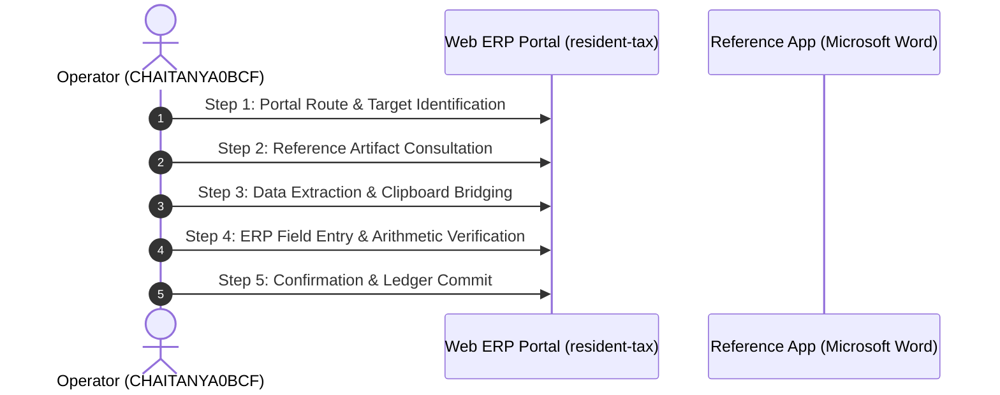

# Deep-Dive Forensic Report: Segment #014
## Process Case: `PO-2026-5097` | Label: `payroll_operations_processing`

> [!NOTE]
> **Execution Metadata**: Recorded in session `ses_20260701-171614-CHAITANYA0BCF` by operator `CHAITANYA0BCF`.
> **Time Span**: `2026-07-01T17:16:27Z` to `2026-07-01T17:17:30Z` (**63.0 seconds** / **1.05 minutes**).
> **Objective**: *Complete resident tax case processing for Tokyo Electron Industry Co., Ltd.*

---

## 1. Quantitative Interaction Telemetry

| Metric | Measured Value | Operational Interpretation |
| :--- | :---: | :--- |
| **Total Interaction Events** | **83** | Full physical event stream count. |
| **Keystrokes Typed** | **12** | Character entries across form fields. |
| **Mouse Clicks** | **22** | Navigation, dropdown, and button activations. |
| **Clipboard Operations** | **3** | Copy/paste bridging events across windows. |
| **App Switches** | **11** | Transitions between browser and reference documents. |
| **Automation Feasibility** | **90.0%** | Suitability for deterministic RPA / API scripting. |

### Active Applications & Window Titles
- **Application**: `Microsoft Edge`
- **Application**: `Microsoft Word`
- **Application**: `Windows Explorer`
  - Window Title: `Opening - Word`
  - Window Title: `Turn off extensions in developer mode`
  - Window Title: `shinkuitorihikisaki_touroku_tetsuzuki [Compatibility Mode] - Word`
  - Window Title: `受発注在庫管理システム - Profile 1 - Microsoft​ Edge`
  - Window Title: `財務会計システム - Profile 1 - Microsoft​ Edge`

### Navigated Web Routes
- `http://127.0.0.1:5132/#/resident-tax`

---

## 2. Inferred Step-by-Step Execution Workflow

### Step 1: Portal Route & Target Identification
- **Action**: Navigate to ERP route 'resident-tax' and locate case 'PO-2026-5097'.
- **Executing System**: `Microsoft Edge`
- **Telemetry Grounding**: DOM URL navigation to ['resident-tax']

### Step 2: Reference Artifact Consultation
- **Action**: Open reference document or desktop window: Turn off extensions in developer mode.
- **Executing System**: `Microsoft Word`
- **Telemetry Grounding**: Application switch to Microsoft Word

### Step 3: Data Extraction & Clipboard Bridging
- **Action**: Highlight and copy required parameters (3 clipboard operations detected).
- **Executing System**: `OS Clipboard Bridge`
- **Telemetry Grounding**: 3 copy/paste clipboard events recorded

### Step 4: ERP Field Entry & Arithmetic Verification
- **Action**: Input case attributes into web form (12 keystrokes, 22 clicks).
- **Executing System**: `Microsoft Edge Web Portal`
- **Telemetry Grounding**: Typing bursts into target form inputs

### Step 5: Confirmation & Ledger Commit
- **Action**: Trigger submission button, verify modal prompt, and commit transaction to database.
- **Executing System**: `ERP Web Portal`
- **Telemetry Grounding**: Form submission / save button click event

---

## 3. Visual Evidence & Screenshot Keyframes

Identified **11 matching screenshot keyframes** during or corresponding to this execution:

- `[PO-2026-5097_scr_smart_1782926187167_monitor_1_post.jpg](../../screenshots/PO-2026-5097_scr_smart_1782926187167_monitor_1_post.jpg)`
- `[PO-2026-5097_scr_smart_1782926198075_monitor_1_post.jpg](../../screenshots/PO-2026-5097_scr_smart_1782926198075_monitor_1_post.jpg)`
- `[PO-2026-5097_scr_smart_1782926218218_monitor_1_post.jpg](../../screenshots/PO-2026-5097_scr_smart_1782926218218_monitor_1_post.jpg)`
- `[PO-2026-5097_scr_smart_1782926227651_monitor_1_post.jpg](../../screenshots/PO-2026-5097_scr_smart_1782926227651_monitor_1_post.jpg)`
