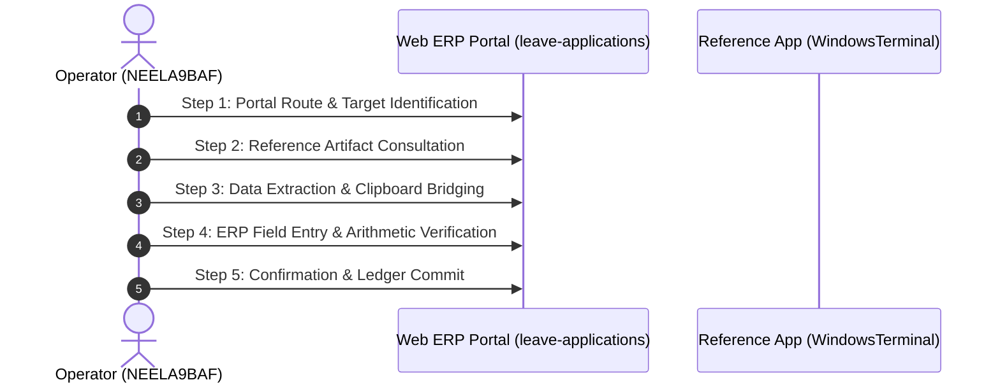

# Deep-Dive Forensic Report: Segment #032
## Process Case: `PAYROLL-ITEMS-2026-001` | Label: `payroll_item_processing`

> [!NOTE]
> **Execution Metadata**: Recorded in session `ses_20260701-173642-NEELA9BAF` by operator `NEELA9BAF`.
> **Time Span**: `2026-07-01T17:36:50Z` to `2026-07-01T17:37:36Z` (**46.0 seconds** / **0.77 minutes**).
> **Objective**: *Finalize the payroll item for the record associated with 沖縄物流センター*

---

## 1. Quantitative Interaction Telemetry

| Metric | Measured Value | Operational Interpretation |
| :--- | :---: | :--- |
| **Total Interaction Events** | **95** | Full physical event stream count. |
| **Keystrokes Typed** | **12** | Character entries across form fields. |
| **Mouse Clicks** | **25** | Navigation, dropdown, and button activations. |
| **Clipboard Operations** | **3** | Copy/paste bridging events across windows. |
| **App Switches** | **9** | Transitions between browser and reference documents. |
| **Automation Feasibility** | **65.0%** | Suitability for deterministic RPA / API scripting. |

### Active Applications & Window Titles
- **Application**: `Microsoft Edge`
- **Application**: `WindowsTerminal`
- **Application**: `ms-teams`
- **Application**: `prl_cc`
  - Window Title: `Settings | Microsoft Teams`
  - Window Title: `Windows PowerShell`
  - Window Title: `財務会計システム and 2 more pages - Profile 1 - Microsoft​ Edge`

### Navigated Web Routes
- `http://127.0.0.1:5132/#/leave-applications`
- `http://127.0.0.1:5132/#/payroll-items`
- `http://127.0.0.1:5132/#/social-insurance`

---

## 2. Inferred Step-by-Step Execution Workflow

### Step 1: Portal Route & Target Identification
- **Action**: Navigate to ERP route 'leave-applications' and locate case 'PAYROLL-ITEMS-2026-001'.
- **Executing System**: `Microsoft Edge`
- **Telemetry Grounding**: DOM URL navigation to ['leave-applications', 'payroll-items']

### Step 2: Reference Artifact Consultation
- **Action**: Open reference document or desktop window: Windows PowerShell.
- **Executing System**: `WindowsTerminal`
- **Telemetry Grounding**: Application switch to WindowsTerminal

### Step 3: Data Extraction & Clipboard Bridging
- **Action**: Highlight and copy required parameters (3 clipboard operations detected).
- **Executing System**: `OS Clipboard Bridge`
- **Telemetry Grounding**: 3 copy/paste clipboard events recorded

### Step 4: ERP Field Entry & Arithmetic Verification
- **Action**: Input case attributes into web form (12 keystrokes, 25 clicks).
- **Executing System**: `Microsoft Edge Web Portal`
- **Telemetry Grounding**: Typing bursts into target form inputs

### Step 5: Confirmation & Ledger Commit
- **Action**: Trigger submission button, verify modal prompt, and commit transaction to database.
- **Executing System**: `ERP Web Portal`
- **Telemetry Grounding**: Form submission / save button click event

---

## 3. Visual Evidence & Screenshot Keyframes

Identified **11 matching screenshot keyframes** during or corresponding to this execution:

- `[PAYROLL-ITEMS-2026-001_scr_smart_1782927411344_monitor_1_post.jpg](../../screenshots/PAYROLL-ITEMS-2026-001_scr_smart_1782927411344_monitor_1_post.jpg)`
- `[PAYROLL-ITEMS-2026-001_scr_smart_1782927419593_monitor_1_post.jpg](../../screenshots/PAYROLL-ITEMS-2026-001_scr_smart_1782927419593_monitor_1_post.jpg)`
- `[PAYROLL-ITEMS-2026-001_scr_smart_1782927431503_monitor_1_post.jpg](../../screenshots/PAYROLL-ITEMS-2026-001_scr_smart_1782927431503_monitor_1_post.jpg)`
- `[PAYROLL-ITEMS-2026-001_scr_smart_1782927442573_monitor_1_post.jpg](../../screenshots/PAYROLL-ITEMS-2026-001_scr_smart_1782927442573_monitor_1_post.jpg)`
