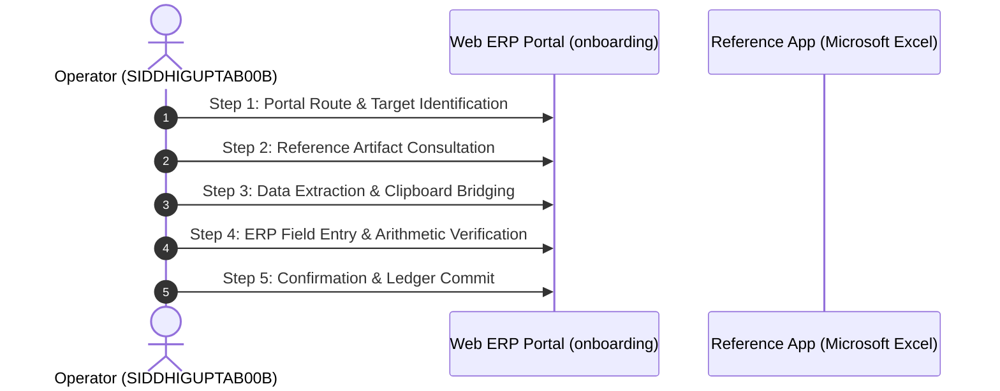

# Deep-Dive Forensic Report: Segment #084
## Process Case: `ONBOARDING-2026-001` | Label: `employee_onboarding_reconciliation`

> [!NOTE]
> **Execution Metadata**: Recorded in session `ses_20260701-181913-SIDDHIGUPTAB00B` by operator `SIDDHIGUPTAB00B`.
> **Time Span**: `2026-07-01T18:19:32Z` to `2026-07-01T18:20:22Z` (**50.0 seconds** / **0.83 minutes**).
> **Objective**: *Complete employee onboarding reconciliation and record any special notes*

---

## 1. Quantitative Interaction Telemetry

| Metric | Measured Value | Operational Interpretation |
| :--- | :---: | :--- |
| **Total Interaction Events** | **106** | Full physical event stream count. |
| **Keystrokes Typed** | **40** | Character entries across form fields. |
| **Mouse Clicks** | **8** | Navigation, dropdown, and button activations. |
| **Clipboard Operations** | **2** | Copy/paste bridging events across windows. |
| **App Switches** | **13** | Transitions between browser and reference documents. |
| **Automation Feasibility** | **100.0%** | Suitability for deterministic RPA / API scripting. |

### Active Applications & Window Titles
- **Application**: `Microsoft Edge`
- **Application**: `Microsoft Excel`
- **Application**: `Microsoft Word`
  - Window Title: `HR人事給与システム - Profile 1 - Microsoft​ Edge`
  - Window Title: `Opening - Excel`
  - Window Title: `Resume Reading`
  - Window Title: `Turn off extensions in developer mode`
  - Window Title: `expense_calc - Excel`

### Navigated Web Routes
- `http://127.0.0.1:5132/#/onboarding`

---

## 2. Inferred Step-by-Step Execution Workflow

### Step 1: Portal Route & Target Identification
- **Action**: Navigate to ERP route 'onboarding' and locate case 'ONBOARDING-2026-001'.
- **Executing System**: `Microsoft Edge`
- **Telemetry Grounding**: DOM URL navigation to ['onboarding']

### Step 2: Reference Artifact Consultation
- **Action**: Open reference document or desktop window: Opening - Excel.
- **Executing System**: `Microsoft Excel`
- **Telemetry Grounding**: Application switch to Microsoft Excel

### Step 3: Data Extraction & Clipboard Bridging
- **Action**: Highlight and copy required parameters (2 clipboard operations detected).
- **Executing System**: `OS Clipboard Bridge`
- **Telemetry Grounding**: 2 copy/paste clipboard events recorded

### Step 4: ERP Field Entry & Arithmetic Verification
- **Action**: Input case attributes into web form (40 keystrokes, 8 clicks).
- **Executing System**: `Microsoft Edge Web Portal`
- **Telemetry Grounding**: Typing bursts into target form inputs

### Step 5: Confirmation & Ledger Commit
- **Action**: Trigger submission button, verify modal prompt, and commit transaction to database.
- **Executing System**: `ERP Web Portal`
- **Telemetry Grounding**: Form submission / save button click event

---

## 3. Visual Evidence & Screenshot Keyframes

Identified **3 matching screenshot keyframes** during or corresponding to this execution:

- `[onboarding_life_ONBOARDING-2026-001_scr_smart_1782931336750_monitor_1_post.jpg](../../screenshots/onboarding_life_ONBOARDING-2026-001_scr_smart_1782931336750_monitor_1_post.jpg)`
- `[onboarding_life_ONBOARDING-2026-001_scr_smart_1782931467195_monitor_1_post.jpg](../../screenshots/onboarding_life_ONBOARDING-2026-001_scr_smart_1782931467195_monitor_1_post.jpg)`
- `[onboarding_life_ONBOARDING-2026-001_scr_smart_1782931590068_monitor_1_post.jpg](../../screenshots/onboarding_life_ONBOARDING-2026-001_scr_smart_1782931590068_monitor_1_post.jpg)`
