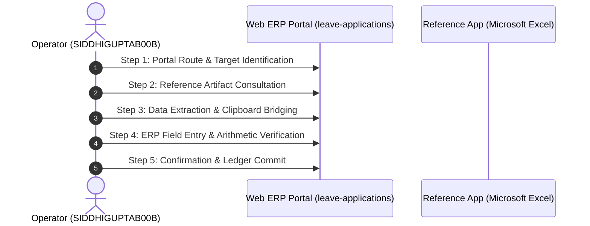

# Deep-Dive Forensic Report: Segment #095
## Process Case: `LEAVE-APPLICATIONS-2026-005` | Label: `leave_application_review`

> [!NOTE]
> **Execution Metadata**: Recorded in session `ses_20260701-181913-SIDDHIGUPTAB00B` by operator `SIDDHIGUPTAB00B`.
> **Time Span**: `2026-07-01T18:21:52Z` to `2026-07-01T18:26:55Z` (**303.0 seconds** / **5.05 minutes**).
> **Objective**: *Decide the employee leave application and document the approval or return reason*

---

## 1. Quantitative Interaction Telemetry

| Metric | Measured Value | Operational Interpretation |
| :--- | :---: | :--- |
| **Total Interaction Events** | **601** | Full physical event stream count. |
| **Keystrokes Typed** | **138** | Character entries across form fields. |
| **Mouse Clicks** | **128** | Navigation, dropdown, and button activations. |
| **Clipboard Operations** | **25** | Copy/paste bridging events across windows. |
| **App Switches** | **53** | Transitions between browser and reference documents. |
| **Automation Feasibility** | **100.0%** | Suitability for deterministic RPA / API scripting. |

### Active Applications & Window Titles
- **Application**: `Microsoft Edge`
- **Application**: `Microsoft Excel`
- **Application**: `Microsoft Word`
- **Application**: `Windows Explorer`
  - Window Title: `File Explorer`
  - Window Title: `HR人事給与システム - Profile 1 - Microsoft​ Edge`
  - Window Title: `Home - File Explorer`
  - Window Title: `Opening - Excel`
  - Window Title: `Resume Reading`

### Navigated Web Routes
- `http://127.0.0.1:5132/#/leave-applications`

---

## 2. Inferred Step-by-Step Execution Workflow

### Step 1: Portal Route & Target Identification
- **Action**: Navigate to ERP route 'leave-applications' and locate case 'LEAVE-APPLICATIONS-2026-005'.
- **Executing System**: `Microsoft Edge`
- **Telemetry Grounding**: DOM URL navigation to ['leave-applications']

### Step 2: Reference Artifact Consultation
- **Action**: Open reference document or desktop window: HR人事給与システム - Profile 1 - Microsoft​ Edge.
- **Executing System**: `Microsoft Excel`
- **Telemetry Grounding**: Application switch to Microsoft Excel

### Step 3: Data Extraction & Clipboard Bridging
- **Action**: Highlight and copy required parameters (25 clipboard operations detected).
- **Executing System**: `OS Clipboard Bridge`
- **Telemetry Grounding**: 25 copy/paste clipboard events recorded

### Step 4: ERP Field Entry & Arithmetic Verification
- **Action**: Input case attributes into web form (138 keystrokes, 128 clicks).
- **Executing System**: `Microsoft Edge Web Portal`
- **Telemetry Grounding**: Typing bursts into target form inputs

### Step 5: Confirmation & Ledger Commit
- **Action**: Trigger submission button, verify modal prompt, and commit transaction to database.
- **Executing System**: `ERP Web Portal`
- **Telemetry Grounding**: Form submission / save button click event

---

## 3. Visual Evidence & Screenshot Keyframes

Identified **3 matching screenshot keyframes** during or corresponding to this execution:

- `[leave_mgmt_LEAVE-APPLICATIONS-2026-005_scr_smart_1782930112943_monitor_1_post.jpg](../../screenshots/leave_mgmt_LEAVE-APPLICATIONS-2026-005_scr_smart_1782930112943_monitor_1_post.jpg)`
- `[leave_mgmt_LEAVE-APPLICATIONS-2026-005_scr_smart_1782930265849_monitor_1_post.jpg](../../screenshots/leave_mgmt_LEAVE-APPLICATIONS-2026-005_scr_smart_1782930265849_monitor_1_post.jpg)`
- `[leave_mgmt_LEAVE-APPLICATIONS-2026-005_scr_smart_1782930413836_monitor_1_post.jpg](../../screenshots/leave_mgmt_LEAVE-APPLICATIONS-2026-005_scr_smart_1782930413836_monitor_1_post.jpg)`
