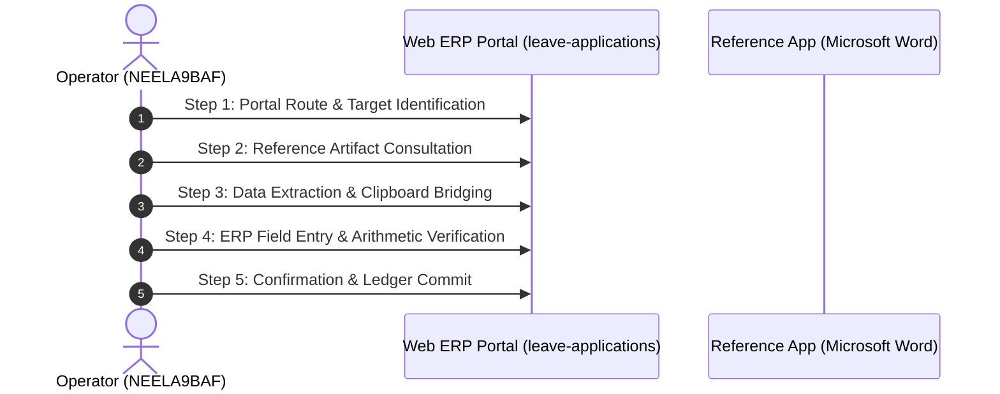

# Deep-Dive Forensic Report: Segment #113
## Process Case: `INV-2026-7506` | Label: `invoice_processing`

> [!NOTE]
> **Execution Metadata**: Recorded in session `ses_20260701-182634-NEELA9BAF` by operator `NEELA9BAF`.
> **Time Span**: `2026-07-01T18:32:03Z` to `2026-07-01T18:34:26Z` (**143.0 seconds** / **2.38 minutes**).
> **Objective**: *Process invoice_processing*

---

## 1. Quantitative Interaction Telemetry

| Metric | Measured Value | Operational Interpretation |
| :--- | :---: | :--- |
| **Total Interaction Events** | **263** | Full physical event stream count. |
| **Keystrokes Typed** | **42** | Character entries across form fields. |
| **Mouse Clicks** | **72** | Navigation, dropdown, and button activations. |
| **Clipboard Operations** | **13** | Copy/paste bridging events across windows. |
| **App Switches** | **21** | Transitions between browser and reference documents. |
| **Automation Feasibility** | **100.0%** | Suitability for deterministic RPA / API scripting. |

### Active Applications & Window Titles
- **Application**: `Microsoft Edge`
- **Application**: `Microsoft Word`
- **Application**: `Windows Explorer`
- **Application**: `prl_cc`
  - Window Title: `File Explorer`
  - Window Title: `HR人事給与システム - Profile 1 - Microsoft​ Edge`
  - Window Title: `Home - File Explorer`
  - Window Title: `Word`
  - Window Title: `getsujitsu_teigaku_torihikisaki_ichiran  -  Compatibility Mode - Word`

### Navigated Web Routes
- `http://127.0.0.1:5132/#/leave-applications`

---

## 2. Inferred Step-by-Step Execution Workflow

### Step 1: Portal Route & Target Identification
- **Action**: Navigate to ERP route 'leave-applications' and locate case 'INV-2026-7506'.
- **Executing System**: `Microsoft Edge`
- **Telemetry Grounding**: DOM URL navigation to ['leave-applications']

### Step 2: Reference Artifact Consultation
- **Action**: Open reference document or desktop window: HR人事給与システム - Profile 1 - Microsoft​ Edge.
- **Executing System**: `Microsoft Word`
- **Telemetry Grounding**: Application switch to Microsoft Word

### Step 3: Data Extraction & Clipboard Bridging
- **Action**: Highlight and copy required parameters (13 clipboard operations detected).
- **Executing System**: `OS Clipboard Bridge`
- **Telemetry Grounding**: 13 copy/paste clipboard events recorded

### Step 4: ERP Field Entry & Arithmetic Verification
- **Action**: Input case attributes into web form (42 keystrokes, 72 clicks).
- **Executing System**: `Microsoft Edge Web Portal`
- **Telemetry Grounding**: Typing bursts into target form inputs

### Step 5: Confirmation & Ledger Commit
- **Action**: Trigger submission button, verify modal prompt, and commit transaction to database.
- **Executing System**: `ERP Web Portal`
- **Telemetry Grounding**: Form submission / save button click event

---

## 3. Visual Evidence & Screenshot Keyframes

Identified **6 matching screenshot keyframes** during or corresponding to this execution:

- `[invoice_payable_INV-2026-7506_scr_smart_1782930724049_monitor_1_post.jpg](../../screenshots/invoice_payable_INV-2026-7506_scr_smart_1782930724049_monitor_1_post.jpg)`
- `[invoice_payable_INV-2026-7506_scr_smart_1782930791299_monitor_1_post.jpg](../../screenshots/invoice_payable_INV-2026-7506_scr_smart_1782930791299_monitor_1_post.jpg)`
- `[invoice_payable_INV-2026-7506_scr_smart_1782930864357_monitor_1_post.jpg](../../screenshots/invoice_payable_INV-2026-7506_scr_smart_1782930864357_monitor_1_post.jpg)`
- `[invoice_payable_INV-2026-8009_scr_smart_1782932811328_monitor_1_post.jpg](../../screenshots/invoice_payable_INV-2026-8009_scr_smart_1782932811328_monitor_1_post.jpg)`
