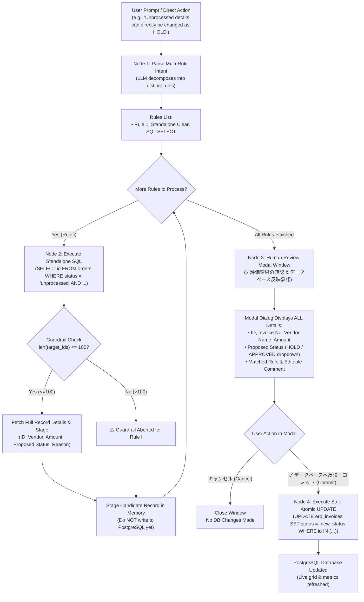

# 財務会計システム - Enterprise Invoice Processing Portal (Version 2)
## Multi-Rule Autonomous LangGraph Routing Agent & Safe Database Pipeline with Human-in-the-Loop Review

---

## 1. Executive Summary

This application is a standalone, dedicated enterprise web portal for the complete family of **Invoice Processing (請求書承認・処理)**, reverse-engineered from the **Dataset B** operational telemetry, standard operating procedures (SOP), and ground-truth screenshots.

The portal implements the **Version 2 Multi-Rule & Human-in-the-Loop Architecture**:
- **Independent Modular Rules**: Rather than mixing multiple criteria into a single gigantic, convoluted SQL statement with nested `OR` operators, the LLM decomposes instructions and policies into **clean, independent rules**.
- **Separate Standalone SQL Commands**: Each rule has its own concise, readable SQL query (e.g. Rule 1 for high-value threshold hold, Rule 2 for routine low-value approvals, Rule 3 for adjustment category freezes).
- **Sequential Execution One-by-One**: The LangGraph state machine iterates through each rule sequentially, executing its SQL query against PostgreSQL, verifying guardrails, and collecting candidate records.
- **Human-in-the-Loop Staging & Pre-Commit Window**:
  - When records (such as all unprocessed details) are identified to be changed to `HOLD` or `APPROVED`, they are **staged first** without immediately writing to PostgreSQL.
  - A dedicated **confirmation window (modal)** automatically opens, displaying all the affected records with complete information: Voucher ID, Invoice No, Vendor Name, Amount, Proposed Status, and Matched Rules/Comments.
  - **Only when the user clicks "Commit to Database" (データベースへ反映・コミット)** are the changes committed to the PostgreSQL database in an atomic transaction.
- **Direct Unprocessed to HOLD Action**:
  - The toolbar features a one-click button `⚡ 未処理を保留にする (Stage Unprocessed as HOLD)` that stages all unprocessed items, opens the review window, and commits only upon confirmation.
- **Single Record Status Modal**:
  - Clicking `✕ 保留` or `✓ 承認` on any row opens a concise confirmation modal with full details before writing changes to PostgreSQL.

---

## 2. Multi-Rule & Staging System Architecture



---

## 3. Directory Layout (`version two of ERP portal`)

All code files reside exclusively inside this directory:

```
version two of ERP portal/
├── langgraph.py         # Core LangGraph multi-rule pipeline, Pydantic schemas, staging engine, database connection
├── app.py               # Standalone Flask web server running on port 5136 with full UI and review modals
├── test_pipeline.py     # Automated test suite (8 comprehensive tests covering multi-rule & human-in-the-loop commit)
├── .env                 # Environment configuration (PostgreSQL credentials, port, OpenAI key)
└── README.md            # Technical specification, SOP alignment, and user guide
```

---

## 4. Key Endpoints & Functions

### 4.1. Staging & Commit Functions in `langgraph.py`
- `stage_agent_decisions(user_prompt: str) -> Dict[str, Any]`:
  Decomposes prompts into independent rules, executes standalone SQL SELECT queries, retrieves full invoice metadata, and returns `staged_decisions` without committing to DB.
- `stage_unprocessed_as_hold(comment: str = "") -> Dict[str, Any]`:
  Directly retrieves all currently unprocessed records from `erp_invoices` / `orders`, stages them as `Hold`, and prepares them for the modal dialog.
- `commit_staged_decisions(decisions: List[Dict[str, Any]]) -> Dict[str, Any]`:
  Executes high-performance grouped atomic SQL UPDATE statements in PostgreSQL for user-confirmed decisions.

### 4.2. Web API Endpoints in `app.py`
- `GET /api/invoices`: Returns invoice records and status distribution counts.
- `POST /api/agent/stage`: Analyzes prompt and returns candidate decisions staged for modal review.
- `POST /api/agent/stage-unprocessed-hold`: Stages all unprocessed invoices as `Hold` and returns candidate list.
- `POST /api/agent/commit`: Receives confirmed decisions from the modal and commits to PostgreSQL.
- `POST /api/invoices/<inv_id>/action`: Updates status and comments for a single record.
- `POST /api/database/reset`: Resets all records back to `unprocessed` for testing.

---

## 5. UI Features & Review Modals

The web portal (`app.py` on `http://127.0.0.1:5136`) strictly reproduces the visual identity of the ERP portal:

1. **Corporate Accounting Header**:
   - Title: `財務会計システム (Financial Accounting Portal)`
   - Department: `2026年度 経理部門 | 請求書承認・処理`
   - Connection status pills for PostgreSQL (Supabase), LangGraph Agent, and LLM.
2. **Left Panel: Invoices Data Grid**:
   - Status metrics: `未処理 (Unprocessed)`, `承認済 (Approved)`, `保留 (On Hold)`, `伝票総数 (Total)`.
   - Real-time filter tabs and search input.
   - Quick toolbar button: `⚡ 未処理を保留にする (Stage Unprocessed as HOLD)`.
   - Row action buttons: `✕ 保留` (opens single review modal), `✓ 承認` (opens single review modal), and `詳細` (opens full voucher breakdown).
3. **Modal 1: Staged Review & Commit Confirmation Window (`#staged-modal`)**:
   - Opens automatically when the agent runs or when `⚡ 未処理を保留にする` is clicked.
   - Summary cards: `承認/確認 予定`, `保留・精査 予定`, `総評価件数`.
   - Filter buttons (`全件表示`, `承認/確認のみ`, `保留のみ`) and keyword search.
   - Scrollable table listing all candidate invoices:
     - ℹ️ detail toggle expanding `.row-detail-box` (Voucher ID, Supplier, Requested Amount, Category, Ref Order, Matched Rule, Reasoning, Audit Comment).
     - Proposed status dropdown (`Hold` / `Approved`).
     - Matched rule badge and editable comment input.
   - Footer buttons: `キャンセル (Cancel)` and `✓ データベースへ反映・コミット (Commit to Database)`.
4. **Modal 2: Single Record Confirmation Window (`#comment-modal`)**:
   - Displays Voucher No, Vendor Name, Amount, Status dropdown, and Comment textarea.
   - Only updates the database when user clicks `💾 保存してDB更新`.
5. **Right Panel: Multi-Rule AI Routing Agent**:
   - Quick example trigger chips including:
     - `⚡ 未処理伝票をすべて保留 (Change Unprocessed to HOLD)`
     - `Approve routine < 500k, freeze > 1M`
     - `Freeze unprocessed orders > 1,000,000`
   - Independent rule cards displaying clean standalone SQL queries and rationales.
   - Live visual pipeline monitor (`Parse Rules` ➔ `Independent SQL` ➔ `Stage Review` ➔ `User Commit`).
   - Dark execution terminal with audit logs.

---

## 6. How to Run

### Step 1: Run the Automated Test Suite (All 8 Tests)
From the repository root:
```powershell
py "version two of ERP portal\test_pipeline.py"
```
**Test Results (100% Pass):**
```
======================================================================
🧪 Running Version 2 LangGraph Multi-Rule & Staging Pipeline Tests
======================================================================
[Test 1] Checking PostgreSQL connection and initial invoice counts...
 -> Connected to PostgreSQL. Initial unprocessed orders: 105
[Test 2] Testing Multi-Rule Decomposition into Separate SQL Commands...
 -> Decomposed into 2 distinct rules with clean standalone SQL
[Test 3] Testing Safety Guardrail threshold (> 100 records)...
 ✅ Guardrail properly aborted runaway bulk execution!
[Test 4] Testing Multi-Rule Execution One-by-One on PostgreSQL...
 ✅ 2 rule(s) successfully executed (68 total rows updated)
[Test 5] Testing Standalone Approval for Hokuriku Parts Industry...
 ✅ Selective approval executed!
[Test 6] Testing 3-Rule Enterprise Policy Execution...
 ✅ 3-Rule independent policy passed!
[Test 7] Testing Human-in-the-Loop Review: Staging without Committing...
 -> Staged Records Count: 68
 -> DB check before commit: Unprocessed count = 105 (DB remains unchanged)
 -> User Confirms & Commits: ✅ Successfully committed 68 records to database.
 -> DB check after commit: Unprocessed count decreased to 37
 ✅ Staged decisions were held in review window and committed only upon user confirmation!
[Test 8] Testing Direct Shift of Unprocessed to HOLD...
 -> Direct Hold Staged Count: 105
 -> DB check before commit: Unprocessed count = 105
 -> User pressed Commit in modal: ✅ Successfully committed 105 records to database.
 -> Final Hold count in PostgreSQL: 105
 ✅ Direct shift to HOLD successfully staged and committed!
======================================================================
🎉 ALL 8 TESTS PASSED! FULL PIPELINE & STAGED MODAL VERIFIED 100%!
======================================================================
```

### Step 2: Access the Live Web Portal
The web server is running on:
```
http://127.0.0.1:5136
```
Open `http://127.0.0.1:5136` in your browser to interact with the portal, stage unprocessed orders to HOLD, review all information in the confirmation window, and commit changes with a single click.
